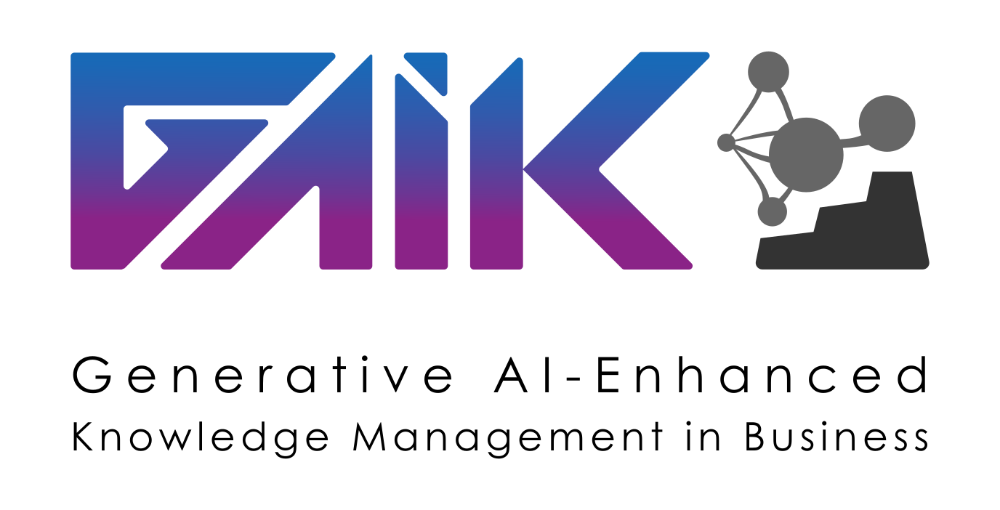
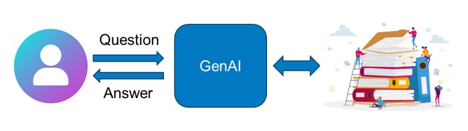
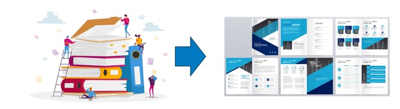
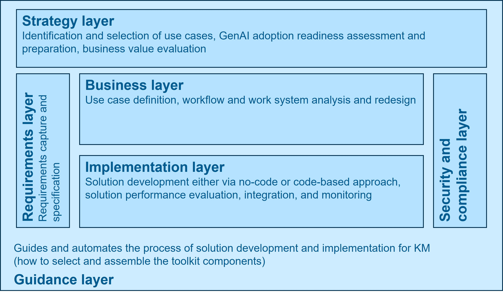

<p align="center">
  <picture>
    <source media="(prefers-color-scheme: dark)" srcset="https://raw.githubusercontent.com/GAIK-project/gaik-toolkit/main/guidance_layer/website/public/logos/SVG/gaik_logo_medium_dark.svg">
    
  </picture>
</p>

<h1 align="center">GAIK Toolkit</h1>

<p align="center">
  Components and guidance for building knowledge-centric generative AI solutions,<br>
  from strategic direction to deployable code. Part of the <a href="https://gaik.ai">GAIK project</a>.
</p>

<p align="center">
  <a href="https://gaik-demo.2.rahtiapp.fi/"></a>
  <a href="https://gaik-project.github.io/gaik-toolkit/"></a>
  <a href="https://pypi.org/project/gaik/"></a>
  <a href="https://discord.gg/sgEFy96vW3"></a>
</p>

<p align="center">
  
  <a href="https://github.com/GAIK-project/gaik-toolkit/blob/main/LICENSE"></a>
</p>

<p align="center">
  <a href="https://gaik-demo.2.rahtiapp.fi/">Live demo</a> ·
  <a href="https://gaik-project.github.io/gaik-toolkit/">Documentation</a> ·
  <a href="https://github.com/GAIK-project/gaik-toolkit/tree/main/implementation_layer/examples">Examples</a> ·
  <a href="https://github.com/GAIK-project/gaik-toolkit#-solution-configuration-wizard">Solution Wizard</a> ·
  <a href="https://github.com/GAIK-project/gaik-toolkit-desktop">Desktop app</a>
</p>

## 🚀 Get started

```bash
pip install "gaik[extract]"   # pick the extras you need, or "gaik[all-cpu]"
```

```python
from gaik.software_components.extractor import DataExtractor
from gaik.software_components.llm import get_llm_config

extractor = DataExtractor(config=get_llm_config("azure"))
```

Each component has its own extra and guide: see [software components](https://gaik-project.github.io/gaik-toolkit/toolkit/software-components/) and the
[examples](https://github.com/GAIK-project/gaik-toolkit/tree/main/implementation_layer/examples).

**🤖 Set up with your coding agent.** Give Claude Code, Codex, Cursor or VS Code this line. It adds gaik to your
project, connects the GAIK MCP server and installs the GAIK agent skills:

```text
Set up GAIK for me. Fetch https://gaik-project.github.io/gaik-toolkit/agent-setup.md and follow it.
```

Every documentation page is also available as markdown for agents: [llms.txt](https://gaik-project.github.io/gaik-toolkit/llms.txt).

## 🧰 What's inside

| | Component | Extra |
| --- | --- | --- |
| 📄 | **Document parsing**: PDF, Word, scans, spreadsheets | `parser-cpu`, `parser`, `spreadsheet-parser` |
| 🧾 | **Structured extraction** into a schema, with the quote each value rests on | `extract`, `source-tracing` |
| 🎙️ | **Transcription** and transcript enhancement | `transcriber`, `enhance-transcript` |
| 🔎 | **Search and RAG**: pgvector hybrid search, reranking, answers | `pg-vector-store`, `rag-workflow` |
| 🏷️ | **Classification** with an LLM or TypeSafe Jev | `classifier`, `jev-classifier` |
| 📝 | **Report writing** from mixed sources, every statement cited | `report-writer` |
| 🗄️ | **Text-to-SQL agents** for PostgreSQL, CSV and Excel | `postgres-agent`, `tabular-agent` |
| 🔊 | **Text-to-speech** | `text-to-speech` |
| ✅ | **Evaluation**: LLM judges and evaluators for extraction, RAG and reports | `llm-judge`, `evaluators` |

Full list in the [software components](https://gaik-project.github.io/gaik-toolkit/toolkit/software-components/) and
[software modules](https://gaik-project.github.io/gaik-toolkit/toolkit/software-modules/) guides. The [live demo](https://gaik-demo.2.rahtiapp.fi/) runs them in the browser.

## 🔗 MCP server

`gaik-mcp` gives an agent six tools: parse a document, transcribe a recording, generate fields, extract fields
with evidence, classify a text and write the fields to Word.

```bash
uvx --from "gaik[mcp]" gaik-mcp --root . --env-file .env
```

`--root` limits file access to one folder and `--env-file` keeps the keys out of the client config. Client
configuration, the HTTP transport and the limits are in [Operations and MCP server](https://gaik-project.github.io/gaik-toolkit/toolkit/operations-and-mcp/).

## 🧭 Solution Configuration Wizard

The wizard turns a plain-language description of a business problem into a validated GenAI solution:

| Output | What it is |
| --- | --- |
| `use_case.blueprint.json` | Source of truth: components, artifacts, workflow steps, schemas, model settings |
| `workflow.bpmn`, `workflow.mmd` | BPMN 2.0 blueprint for stakeholders and a Mermaid flow for developers |
| `poc/` | Runnable proof of concept: `run_poc.py`, requirements, schema, prompt, eval script |
| `docs/` | GenAI product canvas, technical specification, user and developer guides, evaluation plan |

Ways to run it:

- **🌐 Wizard V2 (web):** [wizard-v2-web-gaik.2.rahtiapp.fi](https://wizard-v2-web-gaik.2.rahtiapp.fi), with an approved
  account of the [GAIK demo](https://gaik-demo.2.rahtiapp.fi/). Request access on the demo's
  [Solution Wizard page](https://gaik-demo.2.rahtiapp.fi/solution-wizard).
- **💬 Claude Code or Claude Desktop:** type `/solution-wizard` in this repository.
- **⌨️ Terminal:** `python run_wizard_interactive.py` in `implementation_layer/solution_wizard/` (needs
  `gaik[wizard]` and the `claude` CLI).
- **🛠️ Single steps:** `validate_blueprint.py`, `generate_bpmn.py` and `scaffold_poc.py` in
  `implementation_layer/solution_wizard/scripts/`.

Everything is written to a folder you choose. See the [wizard guide](https://gaik-project.github.io/gaik-toolkit/guidance-layer/solution-configuration-wizard/)
and the [wizard README](https://github.com/GAIK-project/gaik-toolkit/blob/main/implementation_layer/solution_wizard/README.md).

## 🖥️ Desktop app

[gaik-toolkit-desktop](https://github.com/GAIK-project/gaik-toolkit-desktop) (experimental) runs extraction, parsing,
classification and transcription on your own files, on your own computer. See the [Desktop App](https://gaik-project.github.io/gaik-toolkit/desktop-app/) page.

## 🔌 Model providers

Components take one provider config, so the same code runs on any supported provider.
Azure OpenAI is the default.

```python
from gaik.software_components.llm import get_llm_config

config = get_llm_config("google")  # or "azure", "anthropic", "aitta", ...
# pass config to a component, e.g. DataExtractor(config=config)
```

| Provider | `get_llm_config(...)` | Install |
| --- | --- | --- |
| Azure OpenAI (default) | `"azure"` | `pip install gaik` |
| OpenAI | `"openai"` | `pip install gaik` |
| CSC Aitta, other OpenAI-compatible servers | `"aitta"`, `"openai_compatible"` | `pip install gaik` |
| Google Gemini, Vertex AI | `"google"`, `"vertex"` | `pip install "gaik[llm-google]"` |
| Anthropic, Anthropic on Microsoft Foundry | `"anthropic"`, `"anthropic_foundry"` | `pip install "gaik[llm-anthropic]"` |
| Any LiteLLM model (optional backend) | `"litellm"`, e.g. `model="azure/..."` | `pip install "gaik[llm-litellm]"` |

- Structured output and embeddings depend on the model you pick. Audio components run on OpenAI and Azure only.
- The default OpenAI/Azure model is `gpt-6-luna` (0.7.x used `gpt-5.4`). To keep another model, set
  `AZURE_DEPLOYMENT` or `OPENAI_MODEL`, or pass `model=...`.
- Older code keeps working: `get_openai_config(use_azure=...)` and `create_openai_client(config)` are unchanged.

More in the [multi-provider guide](https://gaik-project.github.io/gaik-toolkit/toolkit/multi-provider-llm/) and the
[configuration reference](https://github.com/GAIK-project/gaik-toolkit/blob/main/implementation_layer/README.md#configuration--environment-variables).

## 🎯 About the toolkit

### 💡 Why the toolkit is needed

**Generative AI has significant potential to increase the productivity of knowledge work** 
- Example experiments: consultants using AI were significantly more productive – they completed 12.2% more tasks on average, and completed tasks 25.1% more quickly (Dell'Acqua, 2023) 
- Example cases from practice: Customer-support agents at a large firm selling business-process software demonstrated a 15% increase in productivity when assisted by generative AI (Brynjolfsson, 2025).

**However, tangible business value from Generative AI implementation projects is still limited**
- “only 26% of companies have advanced beyond the proof-of-concept stage to generate value” Source: BCG’s report (de Bellefonds et al, 2024). 
- “Despite $30–40 billion in enterprise investment into GenAI, 95% of organizations are getting zero return.” Source: MIT report (Challapally et al, 2025).

Adopting Generative AI and creating value from **it is especially challenging for small and medium-sized enterprises (SMEs)**, which lack the technical expertise and capabilities to implement GenAI solutions effectively. The literature review of Oldemeyer et al. (2024) identified the following three most frequent challenges for SMEs in the AI implementation in the industrial sector: knowledge, costs, and the low maturity level in digitalization.

### 🧩 Overall approach
Companies can deal with GenAI challenges by combining reusable building blocks with clear guidelines.
Instead of designing solutions from scratch, teams assemble existing components and follow proven ways of working. 
This makes it easier to turn ideas into real results, while reducing implementation time, risk, and required resources, and improving overall solution quality.

### 🔭 Toolkit focus
The knowledge management perspective for structuring GenAI development and implementation activities.

The toolkit focuses on three core **knowledge processes** in organizations:
| Knowledge process | Description | Illustration |
|-----------|-------------|--------------|
| **Knowledge capture** | Extract needed information from business documents, videos, voice recordings, emails, and meeting recordings |  |
| **Knowledge access** | Intelligent access to organizational knowledge (document repositories, databases, wikis, CRMs) |  |
| **Knowledge synthesis** | Automatic generation of business reports, sales proposals, marketing materials, project proposals |  |

The following **generic use cases** are defined as the top priority at the moment:
| Knowledge process | Generic use cases |
|---|---|
| **Knowledge capture** | A. Incident reporting in industry (e.g., for equipment, buildings)<br>B. Creating construction site diaries<br>C. Creation of transcripts and closed captions in various languages for instructional videos and podcasts<br>D. … |
| **Knowledge access** | A. Customer assistant for complex products and services<br>B. Semantic audio and video search for medical instructions<br>C. Learning assistant |
| **Knowledge synthesis** | A. Sales proposal generation<br>B. Report preparation<br>C. … |


### 🏗️ Layer-based architecture

The GAIK Toolkit is organized into a layer-based architecture that spans from strategic planning to implementation and security:

| Layer | Purpose | Contents |
|-------|---------|----------|
| **Strategy Layer** | Identification and selection of use cases, GenAI adoption readiness assessment and preparation | Use case selection framework, AI maturity assessment tool, GenAI success canvas  |
| **Requirements Layer** | Requirements capture and specification | Requirement templates, test cases |
| **Business Layer** | Use case definition, workflow and work system analysis and redesign | GenAI product canvas, Workflow templates, Work systems definitions |
| **Implementation Layer** | Solution development either via no-code or code-based approach, integration, and monitoring | Reusable software components and modules for system development, (`gaik` code package), no-code assets, unit tests, deployment packages, connectors |
| **Evaluation Layer** | Evaluation of the business value of GenAI and of the technical quality of solution outputs | Value evaluation framework, Output evaluation methods (transcription, extraction, LLM-as-judge, RAG, report writing, translation) |
| **Security Compliance Layer** | Security policies and compliance frameworks | Security guidelines, compliance checks, audit trails |
| **Guidance Layer** | Guides and automates the process of solution development and implementation for KM (how to select and assemble building blocks) | Process and guide for GenAI solution implementation, Configuration wizard, Glossary |

This architecture ensures that GenAI solutions are built with proper governance, clear requirements, and comprehensive implementation support.



## 📜 License

This project is licensed under the MIT License – see [`LICENSE`](https://github.com/GAIK-project/gaik-toolkit/blob/main/LICENSE) for details.

<p>
  
</p>
