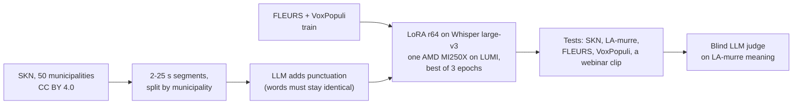

# Finnish dialect speech-to-text: an own Whisper fine-tune

Ready-made speech-to-text models handle standard Finnish well and dialects badly. This page
records how the GAIK project trained a Whisper large-v3 model for Finnish dialect speech on
open data, how it was measured, and where it falls short. The runners, per-segment outputs
and judge records are in the project's private evaluation repository.

**Published on Hugging Face (13 Oct 2026):** the model
[GAIK-project/whisper-large-v3-fi-dialects](https://huggingface.co/GAIK-project/whisper-large-v3-fi-dialects)
(Apache 2.0; "Ours, round 2" below) and its training and test segments
[GAIK-project/skn-finnish-dialects-asr](https://huggingface.co/datasets/GAIK-project/skn-finnish-dialects-asr)
(CC BY 4.0). The model card has the decoding code. Developed by Akseli Leskinen ([laguagu](https://github.com/laguagu)), Haaga-Helia
University of Applied Sciences.

## TL;DR

- On dialect interviews from 10 municipalities that no model was trained on, plain Whisper
  large-v3 has a 40.4 % word error rate and the Finnish fine-tunes on read speech 48–57 %.
  Our LoRA fine-tune of Whisper large-v3 on 62 h of open dialect interviews brings it to
  **21.1 %**, and still writes punctuated sentences.
- On a second dialect corpus it was never trained on, a blind LLM judge counts about half the
  meaning errors of plain Whisper (13.6 against 25.9 points per 100 words).
- Read and formal speech stays at plain Whisper's level (FLEURS 7.6 %, VoxPopuli 10.8 %).
- Weakness: rare names and technical terms in standard-Finnish audio are spelled worse than
  by plain Whisper. For that kind of audio, use plain Whisper large-v3.

## Data

| Corpus | Use | Licence |
|---|---|---|
| Suomen kielen näytteitä (SKN), Kotus via Kielipankki | dialect interviews from 50 municipalities, each sentence with a standard-Finnish transcript: 38 municipalities train (15 042 segments, 62 h), 2 validate, 10 test (600 segments) | CC BY 4.0 |
| FLEURS Finnish (Google) | read sentences: train and test | CC BY 4.0 |
| VoxPopuli Finnish (Meta) | European Parliament speech: train and test | CC0 |
| Lauseopin arkiston murrekorpus (LA-murre), University of Turku and Kotus via Kielipankki | second dialect test: 583 segments from 10 localities outside SKN; one internal model was also trained on its other localities | CC BY-ND 4.0, so that model is not shared |

The split is by municipality, so no test locality or speaker is heard in training. The target
text is SKN's standard-Finnish transcript: the model hears dialect and writes standard Finnish.

## How it was trained

- **Training text.** SKN's standard-Finnish text has no punctuation, so a model trained on it
  writes none. Claude Opus 5.5 added punctuation and capitals to the training text only; an
  answer was kept only if its words were exactly the input's (15 024 of 15 042). Test
  references are the corpora's own human transcripts.
- **Training.** LoRA rank 64 on the attention query and value projections (about 2 % of the
  weights), learning rate 1e-4, batch 8, 25 250 segments, 3 h 14 min on one MI250X. Four
  epochs overfit, so the epoch with the lowest validation loss (the second) is kept.
- **Decoding.** Cut long audio into 15–25 s pieces at quiet points before transcribing.
  Whisper's own long-form loop made a fine-tuned model repeat one phrase about 40 times.

## Results

| Model | SKN dialect WER % | LA-murre judge points | FLEURS WER % | VoxPopuli WER % | Webinar clip WER % |
|---|--:|--:|--:|--:|--:|
| Whisper large-v3 | 40.4 | 25.9 | 7.4 | 12.7 | 15.7 |
| Ours, round 1 (no punctuation, LoRA r32) | 22.2 | 13.8 | 7.8 | 10.6 | 14.9 |
| **Ours, round 2** | **21.1** | **13.6** | 7.6 | 10.8 | 13.9 |
| Ours, round 2 + 56 h of LA-murre (internal) | 19.7 | 11.4 | 7.8 | 11.4 | 15.9 |

WER after lower-casing and removing punctuation. LA-murre's reference is written in dialect, so
WER there ranks spelling; instead Claude Opus 5.5 read the reference and all four transcripts
of each of the 583 segments, unlabelled and shuffled, and counted meaning errors (critical 10,
major 5, minor 1 points per 100 reference words). The webinar clip is the 180 s
[Ajokortti recording](../transcription_eval/README.md), decoded in chunks; on it the judges
find more name and term errors for every dialect model than for plain Whisper.

More dialect speech is what helps most (the internal model), so a larger openly licensed
dialect corpus would be the next step.

## Limits

- One training run per model, one seed, one LLM judge.
- Both dialect corpora are 1960s–70s interviews with elderly speakers, not today's regional
  speech.
- The SKN test shares SKN's transcription conventions with the training data; LA-murre does not.

## Attribution

Suomen kielen näytteitä, Kotimaisten kielten keskus (Kotus), via Kielipankki – The Language
Bank of Finland, CC BY 4.0, [urn:nbn:fi:lb-2020112937](http://urn.fi/urn:nbn:fi:lb-2020112937).
Lauseopin arkiston murrekorpus, University of Turku and Kotus, via Kielipankki, CC BY-ND 4.0,
[urn:nbn:fi:lb-2020112935](http://urn.fi/urn:nbn:fi:lb-2020112935): used for testing only in
the shared model. FLEURS (Google, CC BY 4.0), VoxPopuli (Meta, CC0). Base model
[openai/whisper-large-v3](https://huggingface.co/openai/whisper-large-v3), Apache 2.0. Computing
on LUMI through CSC – IT Center for Science, Finland.
