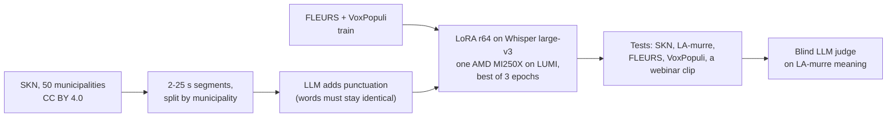

# Finnish dialect speech-to-text: an own Whisper fine-tune

Ready-made speech-to-text models handle standard Finnish well and dialects badly. This page
records how the GAIK project trained a Whisper large-v3 model for Finnish dialect speech on
open data, how it was measured, and where it falls short. The code, the model and dataset
cards and the results are public in
[GAIK-project/finnish-asr](https://github.com/GAIK-project/finnish-asr) (code MIT, results and
documentation CC BY 4.0); texts from the LA-murre corpus, including its judge records, are not
published, because its licence allows no derivatives. A short illustrated walk-through, with audio:
[suomeksi](https://gaik-project.github.io/finnish-asr/story/story.fi.html) ·
[in English](https://gaik-project.github.io/finnish-asr/story/story.en.html).

**Published on Hugging Face (13 Oct 2026):** the model
[GAIK-project/whisper-large-v3-fi-dialects](https://huggingface.co/GAIK-project/whisper-large-v3-fi-dialects)
(Apache 2.0 like Whisper large-v3; "Ours, round 2" below, tagged `v1.0`) and its training and test segments
[GAIK-project/skn-finnish-dialects-asr](https://huggingface.co/datasets/GAIK-project/skn-finnish-dialects-asr)
(CC BY 4.0). The model card has the decoding code. A variant trained with timestamps is on the
model's `timestamps` branch ([below](#timestamp-variant)). Developed by Akseli Leskinen ([laguagu](https://github.com/laguagu)), Haaga-Helia
University of Applied Sciences, GAIK project.

## TL;DR

- On dialect interviews from 10 municipalities that no model was trained on, plain Whisper
  large-v3 has a 40.4 % word error rate and the Finnish fine-tunes on read speech 48–57 %.
  Our LoRA fine-tune of Whisper large-v3 on 62 h of open dialect interviews brings it to
  **21.1 %**, and still writes punctuated sentences.
- On a second dialect corpus it was never trained on, a blind LLM judge gives it about half the
  meaning-error points of plain Whisper (13.6 against 25.9 per 100 words; by count, 5.4 against
  8.5 errors per 100 words).
- Read and formal speech stays at plain Whisper's level (FLEURS 7.6 %, VoxPopuli 10.8 %).
- Weakness: rare names and technical terms in standard-Finnish audio are spelled worse than
  by plain Whisper. For that kind of audio, use plain Whisper large-v3.
- For sentence timestamps, or long audio without manual chunking, the model's `timestamps`
  branch keeps about the same dialect accuracy ([Timestamp variant](#timestamp-variant)).

## Data

| Corpus | Use | Licence |
|---|---|---|
| Suomen kielen näytteitä (SKN), Kotus via Kielipankki | dialect interviews from 50 municipalities, each sentence with a standard-Finnish transcript: 38 municipalities train (15 042 segments, 62 h), 2 validate, 10 test (600 segments) | CC BY 4.0 |
| FLEURS Finnish (Google) | read sentences: train and test | CC BY 4.0 |
| VoxPopuli Finnish (Meta) | European Parliament speech: train and test | CC0 |
| Lauseopin arkiston murrekorpus (LA-murre), University of Turku and Kotus via Kielipankki | second dialect test: 583 segments from 10 localities outside SKN; one internal model was also trained on its other localities | CC BY-ND 4.0, so that model is not shared |

The split is by municipality, so no test locality or interviewee is heard in training (a few
interviewers recorded both test and training municipalities, and their questions are kept). The
test covers five of SKN's six main dialect groups; the Ostrobothnian and Peräpohjola
municipalities are all in training. The target
text is SKN's standard-Finnish transcript: the model hears dialect and writes standard Finnish.

## How it was trained

- **Training text.** SKN's standard-Finnish text has no punctuation, so a model trained on it
  writes none. Claude Opus 5.5 added punctuation and capitals to the training text only; an
  answer was kept only if its words were exactly the input's (15 024 of 15 042). Test
  references are the corpora's own human transcripts.
- **Training.** LoRA rank 64 on the attention query and value projections (about 2 % of the
  weights), learning rate 1e-4, batch 8, 25 250 segments, 3 h 8 min on one MI250X (with
  validation after each epoch). Four epochs overfit, so the epoch with the lowest validation
  loss (the second) is kept.
- **Decoding.** Cut long audio into 15–25 s pieces at quiet points before transcribing.
  Whisper's own long-form loop made a fine-tuned model repeat one phrase about 40 times. For
  long audio without manual chunking, use the [timestamp variant](#timestamp-variant).

## Results

| Model | SKN dialect WER % | LA-murre judge points | FLEURS WER % | VoxPopuli WER % | Webinar clip WER % |
|---|--:|--:|--:|--:|--:|
| Whisper large-v3 | 40.4 | 25.9 | 7.4 | 12.7 | 15.7 |
| Ours, round 1 (no punctuation, LoRA r32) | 22.2 | 13.8 | 7.8 | 10.6 | 14.9 |
| **Ours, round 2** | **21.1** | **13.6** | 7.6 | 10.8 | 13.9 |
| Ours, round 2 + 56 h of LA-murre (internal) | 19.7 | 11.4 | 7.8 | 11.4 | 15.9 |

WER after lower-casing and removing punctuation. LA-murre's reference is written in dialect, so
WER there ranks spelling; instead Claude Opus 5.5 read the reference and all four transcripts
of each of the 583 segments, unlabelled and shuffled, and counted meaning errors (critical 10,
major 5, minor 1 points per 100 reference words). The webinar clip is the 180 s
[Ajokortti recording](../transcription_eval/README.md), decoded in chunks; on it the judges give every dialect model more meaning-error points than
plain Whisper, and the published model gets fewer of the clip's 14 names right (11 and 10
against 14 and 14).

More dialect speech is what helps most (the internal model), so a larger openly licensed
dialect corpus would be the next step.

**Open-model judges agree.** The LA-murre judging was repeated with the same prompt, labels and
order by open models on CSC's Aitta inference service. gpt-oss-120b, on all 583 segments, gives
Whisper large-v3 20.5, round 1 13.4, the published model 13.2 and the internal model 12.9 points,
and prefers the same transcript as Claude in 81 % of pairs. Gemma 4 31B and Qwen3.6-27B, on
the same sample of 200 segments (198 and 197 answered), agree with Claude in 92–93 % of pairs; Gemma
puts round 1 just ahead of the published model. All four judges rank internal < published ≈ round 1 << Whisper large-v3. Their point scales differ, so
compare scores within one judge.

## Timestamp variant

The published model writes timestamps, but almost never where a sentence starts. A second run
with the same recipe trained half of the SKN segments in each epoch with Whisper's timestamp
tokens, taken from SKN's sentence times (15 040 of 15 042 segments had usable times): 3 h 6 min,
best epoch 2. It is on the model's `timestamps` branch; load it with `revision="timestamps"`.

| | Whisper large-v3 | Published (`v1.0`) | `timestamps` branch |
|---|--:|--:|--:|
| SKN dialect WER % | 40.4 | 21.1 | 21.4 |
| FLEURS / VoxPopuli WER % | 7.4 / 12.7 | 7.6 / 10.8 | 7.4 / 11.2 |
| LA-murre judge points (third round) | 24.2 | 13.7 | 13.7 |
| SKN sentence starts found within 1 s | 61 % | 1 % | 58 % |
| Long dialect interviews, sequential with fallback: WER % | 37.5 | 19.8 | 18.1 |
| Same, sentence starts within 1 s | 63 % | 19 % | 49 % |
| Same audio in quiet chunks: WER % | 39.4 | 17.3 | 17.1 |

The third judging round put the three models side by side on 577 of the 583 LA-murre segments:
the variant gets fewer points than the published model in 98 segments and more in 100 (sign test
p = 0.94), so no difference. The long interviews are 10 windows of about 4 minutes from the SKN test
municipalities, decoded with Whisper's own sequential long-form mode. Without temperature
fallback the published model loops in one window (21.5 % WER) and the variant in three (25.2 %);
with OpenAI's fallback settings neither loops. On the webinar clip the variant decodes long-form
with timestamps at 16.7 % WER (16.2 % against the reviewed reference) where the published model
loops (62.7 %); in quiet chunks it is 15.2 / 14.5 % against the published model's 13.9 / 14.0 %.

The variant is slightly worse on VoxPopuli (+0.4) and on the chunked clip (+0.5 to 1.3), which
broke the rule agreed before the run, so the published model stays the main model. Use the
variant when you need sentence timestamps or long audio without manual chunking, and always with
the fallback settings: `temperature=(0.0, 0.2, 0.4, 0.6, 0.8, 1.0)`,
`compression_ratio_threshold=1.35`, `logprob_threshold=-1.0`, `no_speech_threshold=0.6`,
`condition_on_prev_tokens=False`.

## Limits

- One training run per model, one seed. Claude Opus 5.5 is the main judge; the open-model
  judges above check its order, not its exact scores.
- Both dialect corpora are 1960s–70s interviews with elderly speakers, not today's regional
  speech.
- The SKN test shares SKN's transcription conventions with the training data; LA-murre does not.

## Attribution and acknowledgement

Suomen kielen näytteitä, Kotimaisten kielten keskus (Kotus), via Kielipankki – The Language
Bank of Finland, CC BY 4.0, [urn:nbn:fi:lb-2020112937](http://urn.fi/urn:nbn:fi:lb-2020112937).
Lauseopin arkiston murrekorpus, University of Turku and Kotus, via Kielipankki, CC BY-ND 4.0,
[urn:nbn:fi:lb-2020112935](http://urn.fi/urn:nbn:fi:lb-2020112935): used for testing only in
the shared model. FLEURS (Google, CC BY 4.0), VoxPopuli (Meta, CC0). Base model
[openai/whisper-large-v3](https://huggingface.co/openai/whisper-large-v3), Apache 2.0.

We acknowledge CSC – IT Center for Science, Finland for awarding this project access to the LUMI
supercomputer, owned by the EuroHPC Joint Undertaking, hosted by CSC (Finland) and the LUMI
consortium through CSC – IT Center for Science, Finland.
