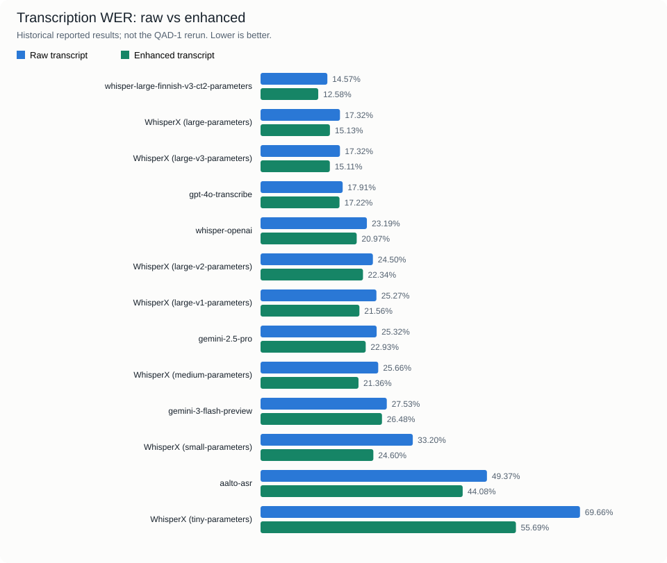
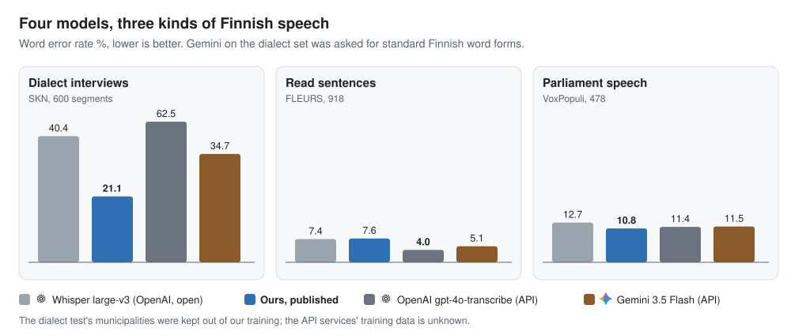
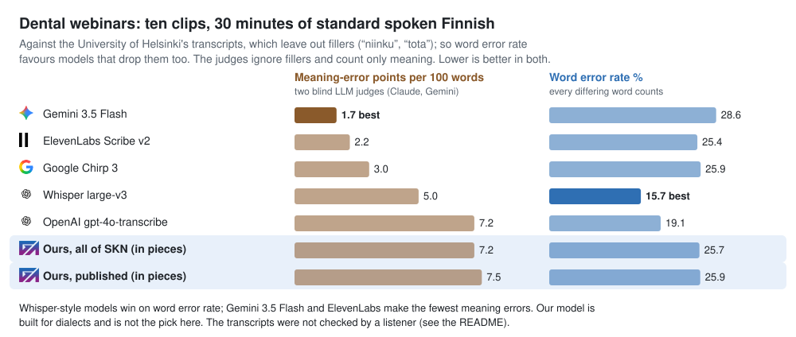
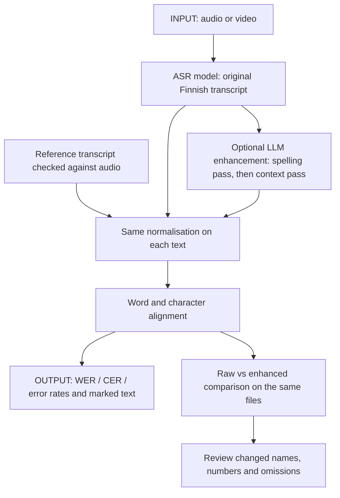

# Transcription evaluation

Compare Finnish speech-to-text outputs with a reference, inspect the aligned errors,
and measure whether transcript enhancement helps. Scoring is offline; enhancement
calls an LLM.

## Results at a glance

- **Historical raw/enhanced comparison:** Finnish-tuned Whisper has the lowest
  reported WER, **14.57% → 12.58%**, a reduction of **1.99 percentage points**.
  All 13 reported model aggregates improve; this does not mean every clip improves.
- **Separate QAD-1 rerun:** on one 180 s Ajokortti clip, QAdental's Finnish-NLP
  WhisperX gets **11.9% WER** and `gpt-4o-mini-transcribe` **13.9%**. HY's saved
  2025 WhisperX output gets **10.4%**, with its model settings unrecorded.
  These are raw transcripts, not the enhanced results below. After a listener reviewed
  the reference's 42 disputed spans, the WhisperX numbers become **15.7%** and **14.0%**
  ([Reviewed reference](#reviewed-reference)).
- **October 2026, five test sets (9.9 h):** our Whisper large-v3 dialect fine-tune halves the errors on
  dialect speech (40 → 21 % WER; every API service 35–63 %). On read and parliament speech the API
  services lead (ElevenLabs Scribe v2: 3.3 % and 9.1 %). On ten dental webinars, two blind LLM judges
  find the fewest meaning errors in Gemini 3.5 Flash and ElevenLabs; WER there favours Whisper because
  the reference leaves fillers out ([below](#october-2026-current-models-and-an-llm-judge)).
- **Interpretation:** WER measures textual differences, including spoken/written
  style and compound spelling. Check names, numbers and missing content directly
  before drawing a conclusion about usefulness.



The chart and table preserve the earlier README's published results in
[`data/historical_results.csv`](data/historical_results.csv). The original
model transcripts, complete clip list, enhancement model/settings and run metadata
are **not present here**, so these historical aggregates cannot be independently
recomputed from this folder. The chart is a rendering of those numbers, not a new run.
The CSV also retains spelling, substitution, deletion and insertion rates.

<!-- historical-results:start -->

| Model | Raw WER % | Enhanced WER % | Reduction (percentage points) |
|---|--:|--:|--:|
| whisper-large-finnish-v3-ct2-parameters | 14.57 | 12.58 | 1.99 |
| WhisperX (large-parameters) | 17.32 | 15.13 | 2.19 |
| WhisperX (large-v3-parameters) | 17.32 | 15.11 | 2.21 |
| gpt-4o-transcribe | 17.91 | 17.22 | 0.69 |
| whisper-openai | 23.19 | 20.97 | 2.22 |
| WhisperX (large-v2-parameters) | 24.50 | 22.34 | 2.16 |
| WhisperX (large-v1-parameters) | 25.27 | 21.56 | 3.71 |
| gemini-2.5-pro | 25.32 | 22.93 | 2.39 |
| WhisperX (medium-parameters) | 25.66 | 21.36 | 4.30 |
| gemini-3-flash-preview | 27.53 | 26.48 | 1.05 |
| WhisperX (small-parameters) | 33.20 | 24.60 | 8.60 |
| aalto-asr | 49.37 | 44.08 | 5.29 |
| WhisperX (tiny-parameters) | 69.66 | 55.69 | 13.97 |

<!-- historical-results:end -->

The QAD-1 rerun's transcripts and scoring code are public, with the October 2026 comparison
below, in [GAIK-project/finnish-asr](https://github.com/GAIK-project/finnish-asr). Its Finnish
reference was reviewed at its 42 disputed spans on 14 Oct 2026 ([below](#reviewed-reference)); the
rest is unverified. Different datasets, references, settings and enhancement stages prevent direct
comparison with the historical table.

## October 2026: current models and an LLM judge

Current speech-to-text models on five Finnish test sets, **9.9 hours of audio in all**, scored
with word error rate (WER) and, where WER misleads, with blind LLM judges that count only
meaning errors. The code, transcripts (where licences allow), scores and judge summaries are in
[GAIK-project/finnish-asr](https://github.com/GAIK-project/finnish-asr).

**Data used**

| Test set | Speech | Size | Reference |
|---|---|--:|---|
| SKN dialect test (Kotus, CC BY 4.0) | dialect interviews, 10 municipalities never used in training | 600 segments, 2.5 h | a person's standard-Finnish transcript |
| LA-murre test (Univ. of Turku / Kotus, CC BY-ND 4.0) | dialect interviews, 10 other localities | 583 segments, 2.3 h | a person's dialect transcript, so judged on meaning |
| FLEURS Finnish test (Google, CC BY 4.0) | Wikipedia sentences read aloud | 918 sentences, 3.3 h | the read text |
| VoxPopuli Finnish test (Meta, CC0) | European Parliament speeches | 478 segments, 1.3 h | the parliament's text |
| Dental webinars (QAdental, HY's QAD-1 set A) | standard spoken Finnish, many brand names and terms | 10 × 180 s clips, 0.5 h | HY's transcript, not listener-checked (below) |



| Model | Type | Dialects (SKN) WER % | Dialects (LA-murre): meaning points | Read (FLEURS) WER % | Parliament (VoxPopuli) WER % | Dental webinars: meaning points | Dental webinars WER % | List price per audio hour |
|---|---|--:|--:|--:|--:|--:|--:|--:|
| Our dialect model ([finnish_dialect_asr](../finnish_dialect_asr/README.md)) | open | **21.1** | **14.2** | 7.6 | 10.8 | 7.5 | 25.9 | own GPU |
| Whisper large-v3 | open | 40.4 | 25.0 | 7.4 | 12.7 | 5.0 | **15.7** | own GPU |
| OpenAI gpt-4o-transcribe (via Azure) | API | 62.5 | 34.2 | 4.0 | 11.4 | 7.2 | 19.1 | $0.36 |
| Gemini 3.5 Flash | API | 34.7 ¹ | 27.2 ¹ | 5.1 | 11.5 | **1.7** | 28.6 | ≈ $0.15 ² |
| ElevenLabs Scribe v2 | API | 44.9 | – | **3.3** | **9.1** | 2.2 | 25.4 | $0.22 |
| Google Chirp 3 | API | 41.3 | – | 4.8 | 11.6 | 3.0 | 25.9 | $0.96 |
| Finnish-NLP whisper-large-finnish-v3 † | open | 56.6 | – | 7.1 † | 6.6 † | – | 25.8 | own GPU |
| RASMUS Finnish-ASR-Canary-v2 + KenLM † | open | 47.6 | – | 7.6 † | 7.7 † | – | 28.6 | own GPU |

WER after lower-casing and removing punctuation. **Meaning points**: errors per 100 reference
words found by blind LLM judges, who ignore fillers, spoken forms and punctuation (critical 10, major
5, minor 1): on LA-murre Claude Opus 5.5 on all 583 segments, with the six transcripts of a segment
judged together (its reference is in dialect, so WER would rank spelling); on the dental webinars the
mean of Claude Opus 5.5 and Gemini 3.1 Pro. † trained on FLEURS and
VoxPopuli, so those two numbers are on familiar material. ¹ asked for standard Finnish word forms
(40.8 % when asked to write as spoken). ² token-priced; 3.5 Flash is no longer on Google's price
list, so estimated at its successor 3.6 Flash's rate. Other prices are list prices on 15 Oct 2026:
OpenAI $0.006/min, ElevenLabs $0.22/h, Chirp 3 $0.016/min (first 500 000 min a month). The open
models need a GPU (about 5 GPU-minutes per audio hour on one AMD MI250X on LUMI).

**What it shows**

- **Dialects:** our fine-tune halves Whisper's errors (40 → 21 %); every API service is at 35–63 %.
  gpt-4o-transcribe condenses dialect speech and leaves out 46 % of the reference's words. On the
  second dialect corpus the judge gives our model 14.2 meaning points, plain Whisper 25.0, Gemini 3.5
  Flash 27.2 and gpt-4o-transcribe 34.2.
- **Read and parliament speech:** the API services lead; ElevenLabs is best on both. Our model
  stays at about Whisper's level (FLEURS 7.6 against 7.4 %, VoxPopuli 10.8 against 12.7 %).
- **Dental webinars:** Gemini 3.5 Flash and ElevenLabs make the fewest meaning errors; plain
  Whisper has the lowest WER only because the reference leaves fillers out, as Whisper does.



**The dental references.** HY's transcripts omit fillers ("niinku", "tota", "no niin") and were
not checked against the audio by a listener; a spot check found a wrong word form and a word
missing at a clip's start. Models that write what is said get 11–14 % of inserted words from that
alone. A listening page that lists the 383 places where most of eleven systems disagree with the
reference is ready for a full review (kept private, since HY's texts are not public); until then,
read the dental WER as agreement with HY's style and the judges as the measure.

<details>
<summary><b>The Ajokortti clip: 20 set-ups, judges and a reviewed reference</b></summary>


Raw transcripts of the 180 s Ajokortti clip ([`data/Ajokortti.mp3`](data/Ajokortti.mp3))
against [`data/reference.txt`](data/reference.txt), Finnish set as the language, no
prompt or word list. The clip is standard spoken Finnish with many names; it is not
dialect speech, and one clip cannot rank models that are close. The code, every transcript,
the scores and the clip's judge records are in
[GAIK-project/finnish-asr](https://github.com/GAIK-project/finnish-asr).

| Model | Type | WER % | CER % | Claude pts | Gemini pts | Names (Claude / Gemini) |
|---|---|--:|--:|--:|--:|--:|
| Gemini 3.5 Flash | API | 14.2 (14.2–17.9) | 5.0 | 0.8 | 1.2 | 14 / 14 of 14 |
| Google Chirp 3 | API | 19.6 | 6.6 | 1.2 | 3.7 | 14 / 11 of 14 |
| Whisper large-v3 | open | 14.7 | 6.0 | 2.7 | 5.2 | 14 / 13 of 14 |
| ElevenLabs Scribe v2 | API | 18.2 (17.2–18.4) | 4.9 | 1.2 | 7.0 | 14 / 12 of 14 |
| Whisper large-v3 turbo | open | 18.4 | 7.7 | 1.5 | 8.5 | 14 / 13 of 14 |
| OpenAI gpt-transcribe | API | 18.4 (18.4–19.1) | 8.5 | 4.2 | 8.5 | 12 / 12 of 14 |
| WhisperX + Finnish-NLP whisper-large-finnish-v3 | open | 11.9 | 3.5 | 4.5 | 8.7 | 13 / 11 of 14 |
| OpenAI gpt-4o-transcribe | API | 16.9 (16.2–18.4) | 6.7 | 6.0 | 7.5 | 11 / 10 of 14 |
| OpenAI whisper-1 | API | 23.1 | 11.2 | 3.0 | 10.4 | 14 / 14 of 14 |
| Finnish-NLP whisper-large-finnish-v3 (plain transformers) | open | 13.2 | 4.3 | 5.2 | 8.5 | 13 / 11 of 14 |
| OpenAI gpt-4o-mini-transcribe | API | 13.9 (13.9–14.7) | 4.4 | 3.2 | 11.4 | 13 / 10 of 14 |
| Orukeet (Parakeet v3 fine-tune) | open | 26.4 | 10.2 | 6.2 | 10.7 | 13 / 11 of 14 |
| RASMUS Finnish-ASR-Canary-v2, greedy | open | 23.9 | 8.1 | 6.5 | 13.7 | 11 / 8 of 14 |
| RASMUS Finnish-ASR-Canary-v2 + KenLM | open | 22.1 | 8.5 | 8.5 | 15.4 | 11 / 7 of 14 |
| Gemini 3.1 Pro | API | 22.4 (15.4–22.4) | 9.3 | 7.0 | 18.4 | 12 / 10 of 14 |
| NVIDIA Canary 1B v2 | open | 24.1 | 10.3 | 9.0 | 17.9 | 13 / 10 of 14 |
| NVIDIA Parakeet TDT 0.6B v3 | open | 31.1 | 13.8 | 12.7 | 17.4 | 13 / 12 of 14 |
| Finnish-NLP wav2vec2 XLS-R 1B (no LM) | open | 31.6 | 9.1 | 6.2 | 26.1 | 13 / 10 of 14 |
| Qwen3-ASR 1.7B | open | 58.0 | 23.2 | 20.6 | 33.6 | 9 / 7 of 14 |
| Qwen3-ASR 0.6B | open | 77.9 | 33.9 | 28.1 | 41.0 | 7 / 4 of 14 |

Sorted by the mean of the two judges. WER and CER use the normalisation described
[below](#what-the-metrics-mean); a range is over three runs. "open" means the weights
can be downloaded and run on your own GPU; these ran on one AMD MI250X on LUMI.

**The LLM judge.** WER charges a dropped filler or "mä" for "minä" as much as a wrong
brand name. Claude Opus 5.5 and Gemini 3.1 Pro each read the reference and one
transcript, without the model's name, and report only what would mislead a reader:
a wrong word, name or number, missing content, invented content. Fillers, spoken
against written forms, compound spacing and punctuation are not errors. **pts** is
error points per 100 reference words (critical 10, major 5, minor 1; lower is better).
**Names** is how many of the clip's 14 names and terms each judge found right or
recognisable. The judges are noisy: an identical transcript scored twice differed by
1.0–1.5 points, so read gaps under about 2 points as ties.

**What it shows.** WER and the judges disagree where a model writes what was said
instead of the reference's standard forms (ElevenLabs: 18.2 % WER, five minor errors
for Claude), and where a model matches the reference's wording but garbles names
(the Finnish-NLP fine-tune: "Nobel-Baker" for Nobel Biocare). For a locally run model
on this kind of audio, Whisper large-v3 is the one to start from. Qwen3-ASR lists
Finnish as supported and is not usable for it here.

**Reviewed reference.** The reference is the University of Helsinki's (HY) QAD-1 transcript of
this clip; it reads like a corrected WhisperX draft, and how it was checked is not recorded. On
14 Oct 2026 Akseli Leskinen (GAIK) listened to the 42 spans where most of seven systems hear
something else and corrected 14 of them: mostly spoken forms written in standard Finnish ("mä" for
"minä", "pikkasen" for "pikkuisen", "nää ei oo" for "nämä eivät ole"), two missing words and a
brand name. The reviewed text is [`data/reference.reviewed.txt`](data/reference.reviewed.txt); the
table above stays against [`data/reference.txt`](data/reference.txt).

| Model | WER %, HY's reference | WER %, reviewed |
|---|--:|--:|
| OpenAI gpt-4o-mini-transcribe | 13.9 | **13.2** |
| Whisper large-v3 | 14.7 | 13.7 |
| Gemini 3.5 Flash | 14.2 | 13.7 |
| Our dialect model ([finnish_dialect_asr](../finnish_dialect_asr/README.md)), chunked | 13.9 | 14.0 |
| ElevenLabs Scribe v2 | 18.2 | 14.2 |
| WhisperX, HY's 2025 run | 10.4 | 14.0 |
| WhisperX + Finnish-NLP whisper-large-finnish-v3 (QAdental's server) | 11.9 | 15.7 |
| Finnish-NLP whisper-large-finnish-v3 (plain transformers) | 13.2 | 15.7 |

The WhisperX-based set-ups lose their lead and ElevenLabs, which writes what is said, gains four
points: HY's text favoured WhisperX output. The best set-ups now sit within about one point, which
one 408-word clip cannot separate. Only the disputed spans were checked; the judges' scores above
were not re-run.

**Fine-tuning on open data does not fix webinar speech.** A LoRA fine-tune of Whisper
large-v3 on the FLEURS and VoxPopuli training sets (10 208 recordings, 51 minutes on one
GPU) improved both public sets but raised WER on the Ajokortti clip from 14.7 % to 17.9 %;
the two judges disagree on its meaning errors (Claude 2.7 → 2.2 points, Gemini 5.2 → 8.2).
The Finnish fine-tunes above follow the same pattern. Public benchmark numbers therefore
say little about spontaneous speech; measure a candidate on your own audio.

</details>

**Dialects.** How the dialect model was trained, the second dialect corpus judged by four LLM judges, and its limits: [`finnish_dialect_asr/`](../finnish_dialect_asr/README.md).

**Acknowledgement.** The open models and the fine-tunes ran on LUMI. We acknowledge CSC – IT Center
for Science, Finland for awarding this project access to the LUMI supercomputer, owned by the
EuroHPC Joint Undertaking, hosted by CSC (Finland) and the LUMI consortium through CSC – IT Center
for Science, Finland.

## Input → method → output



The scoring scripts consume **text**, not audio. Audio is used by the preceding
transcription step and by a person checking the reference.

| Script | Input | Method | Output |
|---|---|---|---|
| [`side_by_side_compare.py`](side_by_side_compare.py) | Reference and hypothesis folders; matching UTF-8 `.txt` filenames | jiwer word/character alignment | `<stem>_side_by_side.txt` per matched file; corpus metrics on stdout |
| [`enhance_transcript.py`](enhance_transcript.py) | Original transcript folder, selected LLM | Two prompt passes; no reference supplied | Enhanced `.txt` files with unchanged filenames; word-count changes on stdout |
| [`eval_enhanced.py`](eval_enhanced.py) | Reference, original and enhanced folders | Score the same matched files before/after | Per-file WER and corpus metrics on stdout |
| [`generate_results.py`](generate_results.py) | Historical CSV snapshot | Sort by raw WER; draw paired bars and a table | This README table and `images/historical-wer.svg`; no API calls |

A file is skipped when a corresponding hypothesis is missing. `eval_enhanced.py`
skips it from **both** aggregates if either version is missing. Check the warnings
and evaluated file count before comparing runs. The scripts overwrite matching
output filenames; use a new output directory to retain an earlier run.

## What the metrics mean

Both scorers lowercase the text, remove Unicode punctuation (including hyphens),
collapse runs of multiple whitespace characters and strip the ends. Word alignment
then splits on spaces; character alignment includes spaces. Number formatting,
Finnish inflections and compound word boundaries are not otherwise normalised.
A single embedded newline is not converted to a space by this transform: keep
comparable whitespace, or explicitly adopt and document a different policy for
both texts. QAD-1 preserves this HY behaviour and also reports a whitespace check.

| Metric | Calculation | Read it as |
|---|---|---|
| WER | `(substitutions + deletions + insertions) / reference words × 100` | Lower is better; can exceed 100% with many insertions |
| CER | Same calculation over reference characters, including spaces | Character differences; useful alongside WER |
| Substitution / deletion / insertion rate | Each error count / reference words × 100 | Wrong, missing or extra words; the three rates sum to WER |
| Spelling error rate | Spelling-close substitutions / reference words × 100 | A subset of substitutions, **not an extra term added to WER** |

“Spelling-close” means Levenshtein distance divided by the **longer** of the two
word lengths is at most 0.4. It is a text-distance heuristic; a close spelling can
still change meaning. Corpus WER uses **summed error counts divided by summed
reference word counts**, not the arithmetic mean of file WERs. Choose acceptance
criteria for your task from reviewed errors; WER alone is not a production gate.

## Run it again

From this folder, install the evaluation dependencies in an isolated environment:

```bash
uv venv .venv
uv pip install --python .venv -r requirements.txt
```

The root toolkit extras do not install jiwer and rapidfuzz. Use this evaluation
environment, or another environment with those dependencies. Commands below use
`python` from that environment (Windows: `.venv/Scripts/python.exe`).

Prepare `reference/`, `original/` and, for enhancement evaluation, `enhanced/`.
Each needs matching filenames, for example `Ajokortti.txt`. The checked-in
[`data/reference.txt`](data/reference.txt) is the sample reference;
[`data/Ajokortti.mp3`](data/Ajokortti.mp3) is the audio. Run your ASR first and save
its text as `original/Ajokortti.txt`.

```bash
python side_by_side_compare.py reference original reports/raw
python enhance_transcript.py --transcripts-dir original --output-dir enhanced --model YOUR_DEPLOYMENT
python eval_enhanced.py reference original enhanced
python side_by_side_compare.py reference enhanced reports/enhanced
python generate_results.py
```

Only the enhancement command needs credentials. Its CLI uses Azure OpenAI and
reads `AZURE_API_KEY` and `AZURE_ENDPOINT`; `--model` is your deployment name.
The current default is `gpt-5.4`. For standard OpenAI, call
`process_transcripts(..., model="YOUR_MODEL", use_azure=False)` from Python with
`OPENAI_API_KEY`. Model configuration describes a new run, not the provenance of
the historical results.

Pass 1 targets small spelling/consistency fixes. Pass 2 targets context, tokenisation
and number spelling, with a prompt limit of four inserted words per 100 words.
These are **prompt instructions**, not enforced guarantees. Review the changes
against the audio, especially names, numbers and anything newly inserted.

## Read an actual output

[`data/side-by-side-comparison.txt`](data/side-by-side-comparison.txt) contains a
saved single-file report: **402 reference words, 39 substitutions, 27 deletions,
1 insertion**. Thus WER is `(39 + 27 + 1) / 402 × 100 = 16.67%`; CER is 7.88%,
spelling error rate 4.98%. The generating model and raw hypothesis are not recorded,
so this is an output-format example, not a named-model benchmark.

The aligned hypothesis marks `[S:reference]` for substitution,
`[S,C:reference]` for a spelling-close substitution, `[D:reference]` for a deletion,
and `[I]` for insertion. The view can be truncated; metrics use the full text.

## Related examples

- [Transcriber examples](../../../implementation_layer/examples/software_components/transcriber/README.md): produce raw and optionally corrected text before scoring.
- [Translation evaluation](../translation_eval/README.md): evaluate the following Finnish-to-English step separately.
- [Evaluation methods](../README.md).
- [Documentation website](https://gaik-project.github.io/gaik-toolkit/evaluation-layer/transcription-eval/).
