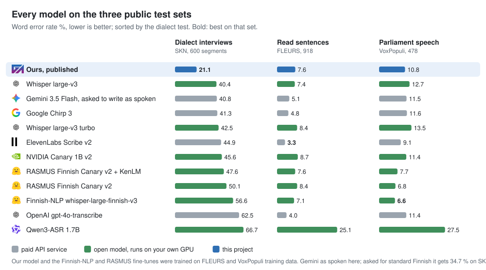

# Finnish speech-to-text benchmark, October 2026

A separate GAIK comparison of current speech-to-text models, added after the evaluation in the
[parent folder](../README.md). It uses its own test sets, references and scoring, so its numbers
are not comparable with the parent folder's raw/enhanced table. The code, transcripts (where
licences allow), scores and judge records are in
[GAIK-project/finnish-asr](https://github.com/GAIK-project/finnish-asr).

## Results at a glance

- **Four Finnish test sets, 9.4 hours of audio.** On dialect speech the GAIK dialect fine-tune of
  Whisper large-v3 halves the errors (40 → 19 % WER); every API service is at 35–63 %
  ([`finnish_dialect_asr/`](../finnish_dialect_asr/README.md)).
- **Read and parliament speech:** the API services lead; ElevenLabs Scribe v2 is best on both
  (3.3 % and 9.1 % WER).
- **One Ajokortti clip:** after a listener reviewed the reference, the best set-ups are within
  about one WER point of each other, which one 408-word clip cannot separate.

## How to read the numbers

| Term | Meaning |
|---|---|
| **WER %** | Word error rate: wrong, missing and extra words divided by the reference's word count, × 100. Text is lower-cased and punctuation removed first. Lower is better. It counts every difference, including a dropped filler or "mä" written for "minä". |
| **CER %** | The same over characters, spaces included. |
| **Meaning points** (also **pts**) | Meaning-error points per 100 reference words, given by a blind LLM judge. Lower is better; 0 means no meaning errors. See below. |
| **Names** | How many of the clip's 14 names and terms (people, companies, products) the judge found right or recognisable. |
| **open / API** | Open weights you run on your own GPU, or a paid cloud service. |
| **SKN, LA-murre** | Two Finnish dialect interview corpora (Kotus; University of Turku and Kotus). |
| **FLEURS, VoxPopuli** | Public test sets: Wikipedia sentences read aloud, and European Parliament speeches. |
| **a range, e.g. 14.2 (14.2–17.9)** | The same API run three times; the services do not give identical output every time. |

### Meaning points

WER treats every textual difference the same, so it cannot tell a harmless spoken form from a
wrong brand name or number. Meaning points count only the errors that would mislead a reader.

1. A judge model (Claude Opus 5.5 or Gemini 3.1 Pro) gets the reference and one transcript, without
   the name of the model that made it.
2. It lists each place where the transcript says something different: a wrong word, name or
   number, missing content, or content that was not said.
3. It does **not** count fillers ("niinku", "tota"), spoken against written forms ("mä"/"minä"),
   dialect against standard Finnish, compound spacing, punctuation or digits against number words.
4. Each error gets a severity and points:

   | Severity | Points | Example |
   |---|--:|---|
   | Critical | 10 | A reader would take away a false fact: a wrong number, a wrong company, a negation flipped, a whole sentence missing or invented |
   | Major | 5 | The meaning of a phrase is lost, a name is unrecognisable, a clause is missing |
   | Minor | 1 | The meaning survives: a recognisable misspelled name, a short word missing |

5. **Meaning points = total points ÷ reference words × 100.**

Example: a 400-word transcript with one major and three minor errors has 5 + 3 = 8 points,
so 8 ÷ 400 × 100 = **2.0 meaning points**. It is not a percentage and not comparable with WER.
The judges are noisy: the same transcript judged twice differed by 1.0–1.5 points, so read gaps
under about 2 points as ties. The judge prompts are in
[finnish-asr `scripts/`](https://github.com/GAIK-project/finnish-asr/tree/main/scripts).

## Data used

| Test set | Speech | Size | Reference |
|---|---|--:|---|
| SKN dialect test (Kotus, CC BY 4.0) | dialect interviews, 10 municipalities never used in training | 600 segments, 2.5 h | a person's standard-Finnish transcript |
| LA-murre test (Univ. of Turku / Kotus, CC BY-ND 4.0) | dialect interviews, 10 other localities | 583 segments, 2.3 h | a person's dialect transcript, so judged on meaning |
| FLEURS Finnish test (Google, CC BY 4.0) | Wikipedia sentences read aloud | 918 sentences, 3.3 h | the read text |
| VoxPopuli Finnish test (Meta, CC0) | European Parliament speeches | 478 segments, 1.3 h | the parliament's text |

## Results

| Model | Type | Dialects (SKN) WER % | Dialects (LA-murre): meaning points | Read (FLEURS) WER % | Parliament (VoxPopuli) WER % | List price per audio hour |
|---|---|--:|--:|--:|--:|--:|
| Our dialect model, main ([finnish_dialect_asr](../finnish_dialect_asr/README.md)) | open | **19.4** | **11.7** ³ | 7.6 | 11.1 | own GPU |
| Our dialect model, first (`v1.0`) | open | 21.1 | 14.2 | 7.6 | 10.8 | own GPU |
| Whisper large-v3 | open | 40.4 | 25.0 | 7.4 | 12.7 | own GPU |
| OpenAI gpt-4o-transcribe (via Azure) | API | 62.5 | 34.2 | 4.0 | 11.4 | $0.36 |
| Gemini 3.5 Flash | API | 34.7 ¹ | 27.2 ¹ | 5.1 | 11.5 | ≈ $0.15 ² |
| ElevenLabs Scribe v2 | API | 44.9 | – | **3.3** | **9.1** | $0.22 |
| Google Chirp 3 | API | 41.3 | – | 4.8 | 11.6 | $0.96 |
| Finnish-NLP whisper-large-finnish-v3 | open | 56.6 | – | 7.1 | 6.6 | own GPU |
| RASMUS Finnish-ASR-Canary-v2 + KenLM | open | 47.6 | – | 7.6 | 7.7 | own GPU |

Meaning points on LA-murre: Claude Opus 5.5 on all 583 segments, with the six transcripts of a
segment judged together (its reference is in dialect, so WER would rank spelling). – = not run. The Finnish-NLP and RASMUS
models were trained on FLEURS and VoxPopuli, so their numbers there are on familiar material. ¹ asked for standard Finnish word forms
(40.8 % when asked to write as spoken). ² token-priced; 3.5 Flash is no longer on Google's price
list, so estimated at its successor 3.6 Flash's rate. Other prices are list prices on 15 Oct 2026:
OpenAI $0.006/min, ElevenLabs $0.22/h, Chirp 3 $0.016/min (first 500 000 min a month). The open
models need a GPU (about 5 GPU-minutes per audio hour on one AMD MI250X on LUMI). ³ judge round 5, where the six
transcripts were the main model, `v1.0` (14.0), `la-murre`, Whisper large-v3 (24.4), Gemini 3.5 Flash (27.1) and
gpt-4o-transcribe (34.0); the other rows are round 4.

Every model, one row each, on the three public test sets
([full table](https://github.com/GAIK-project/finnish-asr#public-test-sets-skn-and-la-murre-dialects-fleurs-and-voxpopuli)):

**What it shows**

- **Dialects:** our fine-tune halves Whisper's errors (40 → 21 %); every API service is at 35–63 %.
  gpt-4o-transcribe condenses dialect speech and leaves out 46 % of the reference's words. On the
  second dialect corpus the judge gives our model 14.2 meaning points, plain Whisper 25.0, Gemini 3.5
  Flash 27.2 and gpt-4o-transcribe 34.2.
- **Read and parliament speech:** the API services lead; ElevenLabs is best on both. Our model
  stays at about Whisper's level (FLEURS 7.6 against 7.4 %, VoxPopuli 10.8 against 12.7 %).

## The Ajokortti clip: 20 set-ups, judges and a reviewed reference

Raw transcripts of the 180 s Ajokortti clip ([`../data/Ajokortti.mp3`](../data/Ajokortti.mp3))
against [`../data/reference.txt`](../data/reference.txt), Finnish set as the language, no
prompt or word list. The clip is standard spoken Finnish with many names; it is not
dialect speech, and one clip cannot rank models that are close.

| Model | Type | WER % | CER % | Claude pts | Gemini pts | Names (Claude / Gemini) |
|---|---|--:|--:|--:|--:|--:|
| Gemini 3.5 Flash | API | 14.2 (14.2–17.9) | 5.0 | 0.8 | 1.2 | 14 / 14 of 14 |
| Google Chirp 3 | API | 19.6 | 6.6 | 1.2 | 3.7 | 14 / 11 of 14 |
| Whisper large-v3 | open | 14.7 | 6.0 | 2.7 | 5.2 | 14 / 13 of 14 |
| ElevenLabs Scribe v2 | API | 18.2 (17.2–18.4) | 4.9 | 1.2 | 7.0 | 14 / 12 of 14 |
| Whisper large-v3 turbo | open | 18.4 | 7.7 | 1.5 | 8.5 | 14 / 13 of 14 |
| OpenAI gpt-transcribe | API | 18.4 (18.4–19.1) | 8.5 | 4.2 | 8.5 | 12 / 12 of 14 |
| WhisperX + Finnish-NLP whisper-large-finnish-v3 | open | 11.9 | 3.5 | 4.5 | 8.7 | 13 / 11 of 14 |
| OpenAI gpt-4o-transcribe | API | 16.9 (16.2–18.4) | 6.7 | 6.0 | 7.5 | 11 / 10 of 14 |
| OpenAI whisper-1 | API | 23.1 | 11.2 | 3.0 | 10.4 | 14 / 14 of 14 |
| Finnish-NLP whisper-large-finnish-v3 (plain transformers) | open | 13.2 | 4.3 | 5.2 | 8.5 | 13 / 11 of 14 |
| OpenAI gpt-4o-mini-transcribe | API | 13.9 (13.9–14.7) | 4.4 | 3.2 | 11.4 | 13 / 10 of 14 |
| Orukeet (Parakeet v3 fine-tune) | open | 26.4 | 10.2 | 6.2 | 10.7 | 13 / 11 of 14 |
| RASMUS Finnish-ASR-Canary-v2, greedy | open | 23.9 | 8.1 | 6.5 | 13.7 | 11 / 8 of 14 |
| RASMUS Finnish-ASR-Canary-v2 + KenLM | open | 22.1 | 8.5 | 8.5 | 15.4 | 11 / 7 of 14 |
| Gemini 3.1 Pro | API | 22.4 (15.4–22.4) | 9.3 | 7.0 | 18.4 | 12 / 10 of 14 |
| NVIDIA Canary 1B v2 | open | 24.1 | 10.3 | 9.0 | 17.9 | 13 / 10 of 14 |
| NVIDIA Parakeet TDT 0.6B v3 | open | 31.1 | 13.8 | 12.7 | 17.4 | 13 / 12 of 14 |
| Finnish-NLP wav2vec2 XLS-R 1B (no LM) | open | 31.6 | 9.1 | 6.2 | 26.1 | 13 / 10 of 14 |
| Qwen3-ASR 1.7B | open | 58.0 | 23.2 | 20.6 | 33.6 | 9 / 7 of 14 |
| Qwen3-ASR 0.6B | open | 77.9 | 33.9 | 28.1 | 41.0 | 7 / 4 of 14 |

Sorted by the mean of the two judges' meaning points. "Claude pts" and "Gemini pts" are the
meaning points of each judge ([above](#meaning-points)). The open models ran on one AMD MI250X on LUMI.

**What it shows.** WER and the judges disagree where a model writes what was said instead of the
reference's standard forms (ElevenLabs: 18.2 % WER, five minor errors for Claude), and where a
model matches the reference's wording but garbles names (the Finnish-NLP fine-tune: "Nobel-Baker"
for Nobel Biocare). For a locally run model on this kind of audio, Whisper large-v3 is the one to
start from. Qwen3-ASR lists Finnish as supported and is not usable for it here.

**Reviewed reference.** The reference is the University of Helsinki's (HY) QAD-1 transcript of
this clip; it reads like a corrected WhisperX draft, and how it was checked is not recorded. On
14 Oct 2026 Akseli Leskinen (GAIK) listened to the 42 spans where most of seven systems hear
something else and corrected 14 of them: mostly spoken forms written in standard Finnish ("mä" for
"minä", "pikkasen" for "pikkuisen", "nää ei oo" for "nämä eivät ole"), two missing words and a
brand name. The reviewed text is [`data/reference.reviewed.txt`](data/reference.reviewed.txt); the
table above stays against [`../data/reference.txt`](../data/reference.txt).

| Model | WER %, HY's reference | WER %, reviewed |
|---|--:|--:|
| OpenAI gpt-4o-mini-transcribe | 13.9 | **13.2** |
| Whisper large-v3 | 14.7 | 13.7 |
| Gemini 3.5 Flash | 14.2 | 13.7 |
| Our dialect model ([finnish_dialect_asr](../finnish_dialect_asr/README.md)), chunked | 13.9 | 14.0 |
| ElevenLabs Scribe v2 | 18.2 | 14.2 |
| WhisperX, HY's 2025 run | 10.4 | 14.0 |
| WhisperX + Finnish-NLP whisper-large-finnish-v3 (QAdental's server) | 11.9 | 15.7 |
| Finnish-NLP whisper-large-finnish-v3 (plain transformers) | 13.2 | 15.7 |

The WhisperX-based set-ups lose their lead and ElevenLabs, which writes what is said, gains four
points: HY's text favoured WhisperX output. The best set-ups now sit within about one point, which
one 408-word clip cannot separate. Only the disputed spans were checked; the judges' scores above
were not re-run.

**Re-check (21 Oct 2026).** The seven API set-ups were run again with the same settings, and 33
transcripts were scored with a separate normaliser that splits hyphenated words, so its numbers sit
a few tenths from the tables above. Four findings:

- Every WhisperX or Finnish-NLP set-up, and HY's 2025 Whisper run, scores 2.1–3.0 points worse
  against the reviewed text; no other set-up loses more than 1.5.
- The review did not favour the seven systems that picked the spans, four of them OpenAI's: fresh
  OpenAI runs move by −0.4 to +1.5 points, and ElevenLabs, which was not among them, gains most (−3.3).
- One run per model cannot rank them: against the reviewed text gpt-4o-transcribe scored 16.0 % in
  the earlier run and 20.3 % now, and Gemini 3.1 Pro 20.1 % and 12.1 %.
- Leaving out the 15 reference words the review changed, the Finnish-NLP model (9.9 %) and HY's
  WhisperX run (10.2 %) still score lowest. The unchecked rest of the reference may still follow
  WhisperX's wording, or the model may be that good; WER alone cannot tell which.

**Fine-tuning on open data does not fix webinar speech.** A LoRA fine-tune of Whisper
large-v3 on the FLEURS and VoxPopuli training sets (10 208 recordings, 51 minutes on one
GPU) improved both public sets but raised WER on the Ajokortti clip from 14.7 % to 17.9 %;
the two judges disagree on its meaning errors (Claude 2.7 → 2.2 points, Gemini 5.2 → 8.2).
The Finnish fine-tunes above follow the same pattern. Public benchmark numbers therefore
say little about spontaneous speech; measure a candidate on your own audio.

## Acknowledgement

The open models and the fine-tunes ran on LUMI. We acknowledge CSC – IT Center for Science,
Finland for awarding this project access to the LUMI supercomputer, owned by the EuroHPC Joint
Undertaking, hosted by CSC (Finland) and the LUMI consortium through CSC – IT Center for Science,
Finland.
