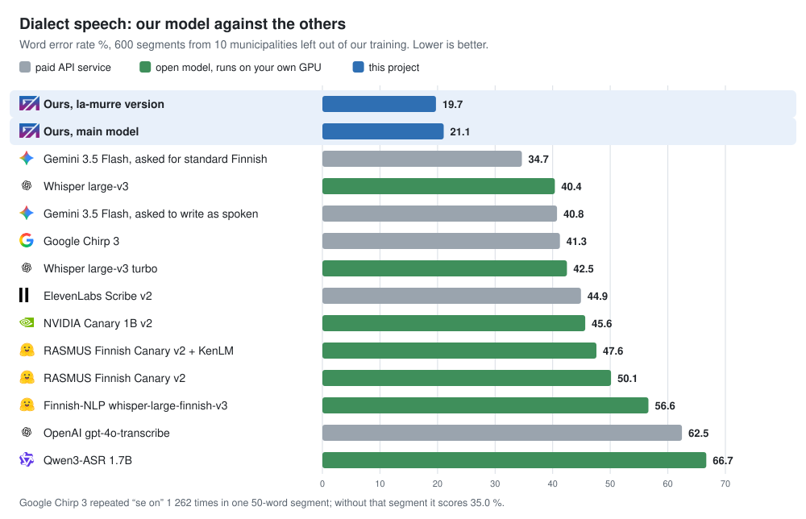
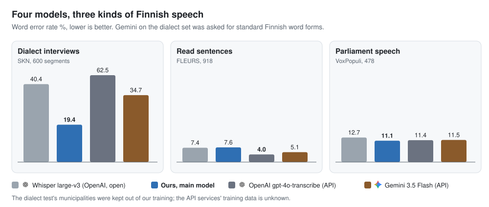
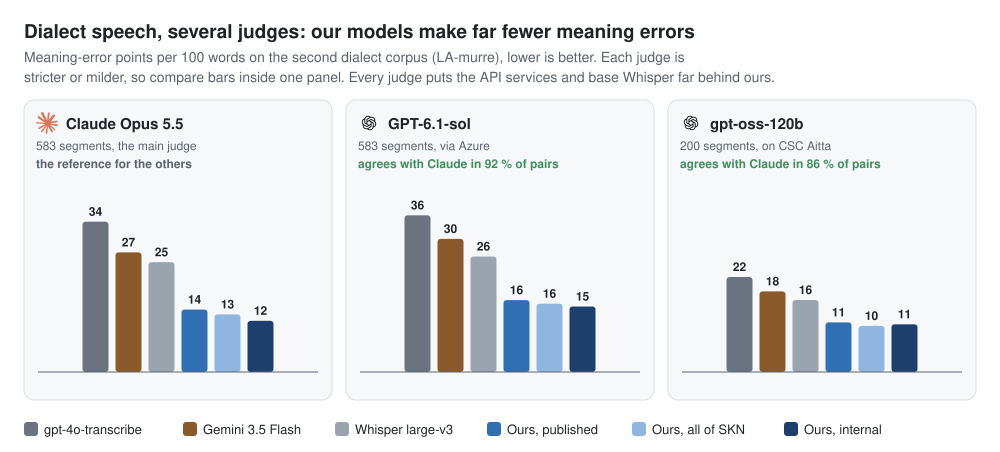

# Finnish dialect speech-to-text: an own Whisper fine-tune

Ready-made speech-to-text models handle standard Finnish well and dialects badly. The GAIK
project trained Whisper large-v3 on open Finnish dialect interviews; it halves the errors on
dialect speech. Everything (code, results, figures) is in
**[GAIK-project/finnish-asr](https://github.com/GAIK-project/finnish-asr)**.

🤗 [Model](https://huggingface.co/GAIK-project/whisper-large-v3-fi-dialects) ·
🗂️ [Training data](https://huggingface.co/datasets/GAIK-project/skn-finnish-dialects-asr) ·
🔊 [Listen and compare](https://gaik-project.github.io/finnish-asr/listen.html) ·
📖 Story: [suomeksi](https://gaik-project.github.io/finnish-asr/story/story.fi.html) ·
[in English](https://gaik-project.github.io/finnish-asr/story/story.en.html)

## Results

| Model | Dialects (SKN) WER % | Dialects (LA-murre): meaning points | Read (FLEURS) WER % | Parliament (VoxPopuli) WER % |
|---|--:|--:|--:|--:|
| **Ours** | **21.1** | **14.2** | 7.6 | 10.8 |
| Whisper large-v3 | 40.4 | 25.0 | 7.4 | 12.7 |
| Gemini 3.5 Flash | 34.7 ¹ | 27.2 ¹ | 5.1 | 11.5 |
| OpenAI gpt-4o-transcribe | 62.5 | 34.2 | 4.0 | 11.4 |
| ElevenLabs Scribe v2 | 44.9 | – | **3.3** | **9.1** |
| Google Chirp 3 | 41.3 | – | 4.8 | 11.6 |

Lower is better. WER: wrong, missing and extra words per 100 reference words. Meaning points:
meaning-error points per 100 reference words from a blind LLM judge (Claude Opus 5.5, 583 segments;
critical error 10 points, major 5, minor 1; dialect forms, fillers and punctuation are not errors).
How they are counted: [finnish_asr_benchmark](../finnish_asr_benchmark/README.md#meaning-points).
¹ asked for standard Finnish.

A second dialect corpus (LA-murre, 10 localities no model was trained on) has dialect-spelled
references, so blind LLM judges (Claude Opus 5.5, GPT-6.1-sol, gpt-oss-120b) counted meaning errors
instead of WER. Every judge puts our models far ahead, and gpt-4o-transcribe and Gemini 3.5 Flash
behind plain Whisper:

Two variants are separate branches, not the main model, because they make more word errors on
parliament speech:

- [`la-murre`](https://huggingface.co/GAIK-project/whisper-large-v3-fi-dialects/tree/la-murre):
  also trained on 56 h of LA-murre interviews from other localities. The best on dialects: SKN
  19.7 % WER, 11.6 meaning points on LA-murre. Use it for audio that is mostly dialect.
- [`all-skn`](https://huggingface.co/GAIK-project/whisper-large-v3-fi-dialects/tree/all-skn):
  trained on all 50 SKN municipalities, 13.1 meaning points on LA-murre.

## How it was made

- **Data:** 62 h of dialect interviews from 38 municipalities (SKN, Kotus, CC BY 4.0), each
  sentence with a person's standard-Finnish transcript, plus FLEURS and VoxPopuli. The 10 test
  municipalities were kept out of training.
- **Training:** LoRA on Whisper large-v3, about 3 h on one AMD MI250X on LUMI.
- **Use it for** dialect and older speakers' speech. For standard Finnish full of brand names, plain
  Whisper large-v3 or an API service is better ([finnish_asr_benchmark](../finnish_asr_benchmark/README.md)).

Details, every model's numbers, the timestamp variant and the limits:
[finnish-asr README](https://github.com/GAIK-project/finnish-asr#readme).

## Attribution and acknowledgement

Suomen kielen näytteitä, Kotus, via Kielipankki, CC BY 4.0,
[urn:nbn:fi:lb-2020112937](http://urn.fi/urn:nbn:fi:lb-2020112937). Lauseopin arkiston
murrekorpus, University of Turku and Kotus, via Kielipankki, CC BY-ND 4.0,
[urn:nbn:fi:lb-2020112935](http://urn.fi/urn:nbn:fi:lb-2020112935), used for testing and to train
the `la-murre` branch (its rewritten texts are not published). FLEURS (Google, CC BY 4.0), VoxPopuli (Meta, CC0). Base model
[openai/whisper-large-v3](https://huggingface.co/openai/whisper-large-v3), Apache 2.0.
Developed by Akseli Leskinen ([laguagu](https://github.com/laguagu)), Haaga-Helia University of
Applied Sciences, GAIK project.

We acknowledge CSC – IT Center for Science, Finland for awarding this project access to the LUMI
supercomputer, owned by the EuroHPC Joint Undertaking, hosted by CSC (Finland) and the LUMI
consortium through CSC – IT Center for Science, Finland.
