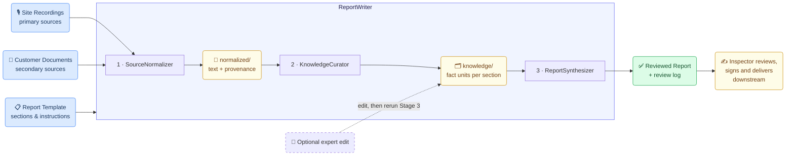
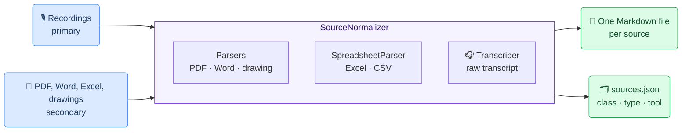
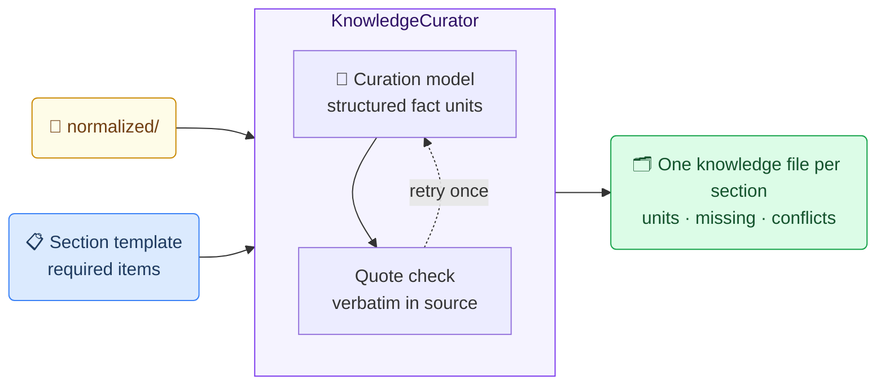
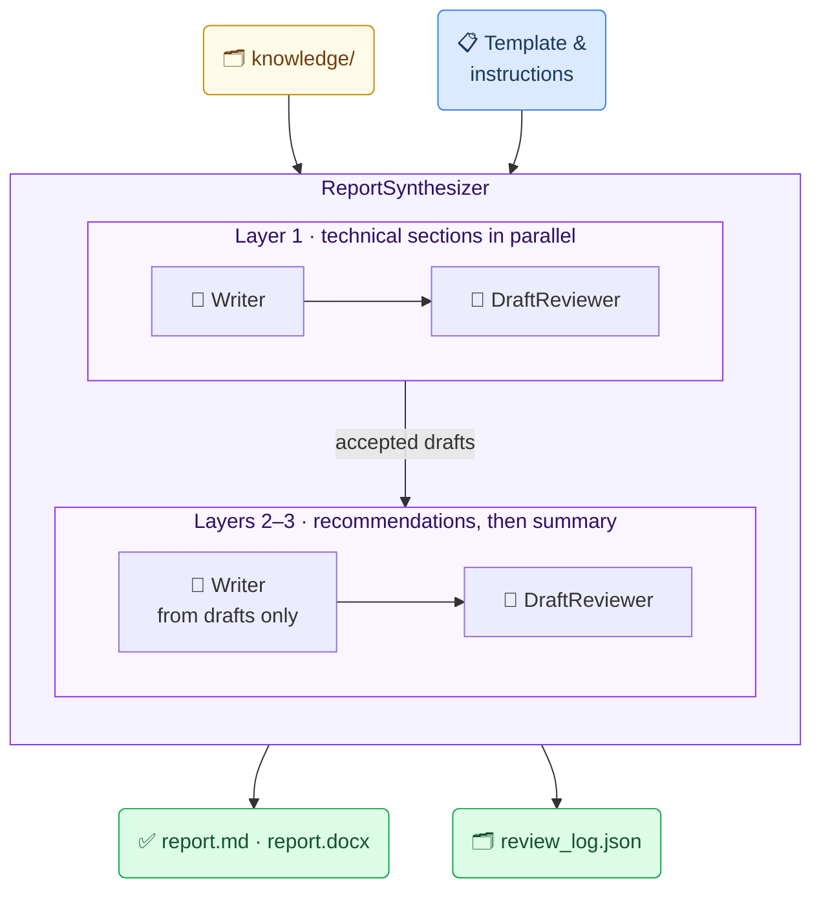
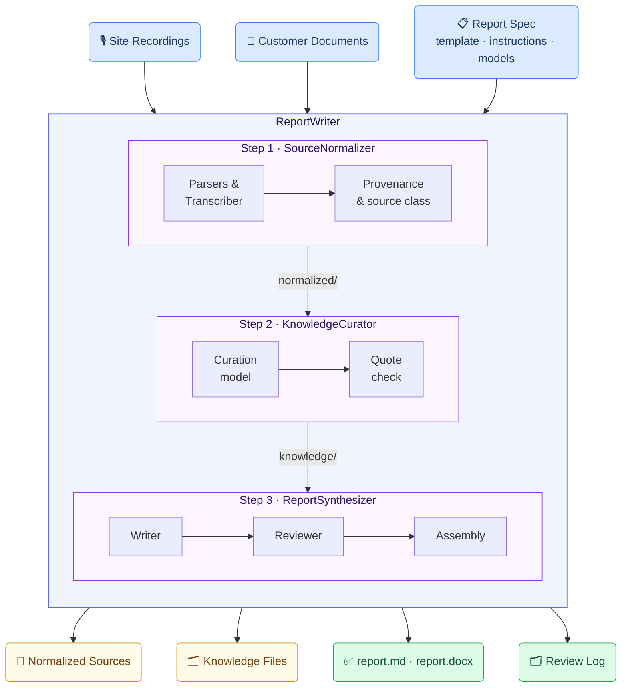

# Report Writing Generic Use Case (Cross-Cutting Use Case)

The report writing use case illustrates how the toolkit connects use case design, value evaluation, and implementation into a single GenAI-enabled solution for professional reports that merge firsthand observations with background documents. A construction report for a house is the worked example: an inspector's site recordings and the customer's documents become a draft on the company template, in which every statement can be traced to its source, and the inspector signs it.

---

## Business layer – use case specification

At the business layer, the use case is specified using the GenAI product canvas. The focus is on construction reports for houses and apartments, such as an inspector's report on the condition of a property. A customer, typically a buyer, a seller or an owner planning a renovation, orders a report and supplies the documentation they have: building and renovation reports, drawings, technical data and maintenance records. An inspector visits the property and dictates observations while walking through it.

Today the inspector writes the report by hand, merging what was observed on site with what the documents say. This takes hours per report. The documents differ in age, format and reliability, and an error or an untraceable statement weakens a report that the inspector signs and is accountable for. The canvas clarifies the purpose of the solution (a source-grounded draft on the company template), the main users (the inspector who produces and signs the report, a senior inspector who may review it for quality assurance, and the customer who receives it) and the knowledge processes involved: knowledge capture on site and knowledge synthesis into the report.

Concrete example fragments reflected in the use case design include:
- Observations are dictated on site, area by area, with the date and time spoken at the start of each recording
- Background documents come from the customer and differ in age, format and reliability
- The report follows a fixed template with sections such as structures, wet rooms, building services and electrical systems, followed by recommendations and preceded by a summary
- Current observations take precedence over older documents, and required information that is not available is marked as missing rather than filled in
- Success is defined as less writing time per report, fewer factual errors, and every statement traceable to its source

The canvas provides a shared understanding of what the GenAI solution does and why it is valuable, without going into technical implementation details.

[](/images/report-writing-canvas.png)

- **Reference GenAI Product Description for Report Writing** - [Download Raw File (GenAI_product_canvas_Report writing_v0.1.pptx)](https://github.com/GAIK-project/gaik-toolkit/blob/main/business_layer/genAI_product_canvas/GenAI_product_canvas_Report%20writing_v0.1.pptx)

The BPMN process model shows how this use case runs: who performs each step (the customer, the inspector, the GenAI report writer and the company systems), and where the inspector reviews, corrects and signs the draft.

[](/images/report-writing-bpmn.png)

- **Reference BPMN process model for Report Writing** — [Download (report-writing-bpmn.png)](/images/report-writing-bpmn.png)

---

## Strategy layer – value evaluation and monitoring

At the strategy layer, the value evaluation model for report writing applies the [Value Evaluation Framework](https://github.com/GAIK-project/gaik-toolkit/blob/main/evaluation_layer/value_evaluation_framework/README.md) to this generic use case and makes value assumptions explicit.

Example value fragments from the model include:

Functional value (primary):
"Faster report writing", "Less manual merging of sources", "Consistent template structure", "No required item silently left out"
→ Outcome: More reports completed per inspector, with fewer revision rounds

Informational value:
"Every statement traceable to a source", "Conflicts between sources made visible", "Reusable section-bound knowledge"
→ Outcome: Reports that can be checked, audited and reused

Financial value:
"Lower writing effort per report", "Fewer corrections after delivery", "Higher report throughput"
→ Outcome: Lower cost per report

Emotional value:
"Confidence in signing the report", "Less routine writing", "Trust in the draft"
→ Outcome: Inspectors spend their time on inspection and judgement

Social value:
"Clear, consistent reports for customers", "Transparent basis for property decisions", "Shared quality standard across inspectors"
→ Outcome: Stronger customer trust in the report

The same model can be used both before implementation (to evaluate expected value) and after deployment (to monitor realized value across different dimensions).

[](/images/report-writing-value.png)

The source version of the **Value evaluation model: Report writing** - [Download Raw File (Value_evaluation_model_for Report_writing_v0.1.pptx)](https://github.com/GAIK-project/gaik-toolkit/blob/main/evaluation_layer/value_evaluation_framework/Value_evaluation_model_for%20Report_writing_v0.1.pptx)

---

## Implementation layer using No-Code

Report writing can be supported by Generative AI using a no-code approach. At the implementation layer, the use case can be realized with a no-code asset from the toolkit:
1) [Report Writing Claude Skill](https://github.com/GAIK-project/gaik-toolkit/blob/main/implementation_layer/no-code-assets/agent-skills/skills/report-writing/README.md)

The Claude Skill reads a folder of source files: it transcribes recordings, reads PDF, Word, Excel and PowerPoint files and images, and writes a Word report. It follows an optional template and an optional sample report. No custom software development is needed.

What the business user sets up (once):

An inspection manager prepares reference material, not code:
- a blank report template with the company's fixed section structure
- a sample report that shows the expected tone and format
- a short set of written instructions, added to each request. Conceptually, they say:
  - "Narrate site observations directly; attribute document content to the document and its year"
  - "When an observation contradicts a document, follow the observation and mention the document"
  - "If a required item is not covered by the sources, write `(missing: item)`"
  - "Do not copy facts from the sample report"

This material acts like a digital reporting policy.

What happens in daily work:

**Step 1 – Record on site**
The inspector records voice notes while walking through the property:
- one recording per area, for example exterior and attic, interior and wet rooms, and building services
- the date, time and area spoken at the start of each recording

**Step 2 – Collect the documents**
The customer's documents and the recordings go into one folder.

**Step 3 – Generate the draft**
The inspector asks Claude to create the report from the folder using the skill, and adds the written instructions.

**Step 4 – Review and sign**
The inspector reads the draft, corrects it where needed and signs it.

Example of what the business gets out:

A draft on the company template, with sentences such as:

- "According to the 1998 renovation report, the mechanical ventilation system had a design life of 25 years."
- "It was observed that the basement supply-air unit ran but produced unusual vibration, with surface rust visible on the housing."
- "Latest electrical inspection record: `(missing: latest electrical inspection record)`"

This makes the result:
- a ready first draft on the company template
- consistent in how observations and documents are cited
- explicit about gaps instead of guessing
- quick for the inspector to review and sign

The no-code route is quick to adopt, but all sources share one context: there is no saved, section-by-section knowledge that the inspector can inspect or correct, the same model writes and checks the text, and the source rules are only as reliable as the prompt. Where reports carry liability or volumes are high, the code-based method below adds these controls.

---

## Implementation Layer Using Code-Based Method.

The code-based method follows CURACT (Curation-Anchored, Governed, Traceable Reporting). Instead of writing the report straight from the sources, it first collects the facts for each report section, each with the exact words of its source, and saves them as files that a person can read and correct. The report is then written only from these facts, and a separate model checks each section.

Three software components implement the three stages: **SourceNormalizer**, **KnowledgeCurator** and **ReportSynthesizer**. The **ReportWriter** module combines them. Reviewing, signing and delivering the report remain downstream tasks outside the GenAI pipeline.



| Stage | What happens | Component | Saved result |
|-------|--------------|-----------|--------------|
| 1 · Ingestion and normalization | Each recording is transcribed and each document is parsed into text. Every source is tagged as primary (site recordings) or secondary (customer documents) and recorded with its origin. | SourceNormalizer | `normalized/`: one text file per source |
| 2 · Section-bound curation | For each report section, the facts are extracted with a verbatim quote of their source, together with the required items that no source covers and the conflicts between sources. | KnowledgeCurator | `knowledge/`: one file per section |
| 3 · Governed synthesis | A writer model drafts each section from its own facts only, and a separate reviewer model checks the draft. The recommendations and the summary are written last, from the accepted drafts. | ReportSynthesizer | `report/`: `report.docx`, `report.md` and a review log |

Each fact pairs a short summary with the exact words of its source, for example *"Mechanical ventilation was installed in the 1998 renovation with a 25-year design life"*, quoted from page 3 of the 1998 renovation report. The knowledge files are plain JSON, so an inspector can correct, delete or add a fact before the report is written, and only Stage 3 is rerun.

<Callout type="info">
The design follows the seven CURACT principles: source grounding, knowledge filtering before writing, persistence and provenance, source hierarchy, role separation, human checkpoints and explicit missing data. In this use case, human checkpoints are optional rather than mandatory, the user supplies only relevant sources, and site photos are left out. The [expected behaviours](https://github.com/GAIK-project/gaik-toolkit/blob/main/implementation_layer/examples/software_modules/report_writer/house_condition_assessment/expected_behaviours.md) of the example case check each principle.
</Callout>

---

## Software Components

### 1. SourceNormalizer (Stage 1)

Converts every input into text with its provenance, using existing toolkit components: the Parsers for PDF, Word and spreadsheets, the vision parser for drawings, and the Transcriber for recordings. The raw transcript is kept, because the curator quotes it word for word. An unsupported, unreadable or empty file stops the run instead of being skipped.



> 📁 [`implementation_layer/src/gaik/software_components/source_normalizer/`](https://github.com/GAIK-project/gaik-toolkit/tree/main/implementation_layer/src/gaik/software_components/source_normalizer)

---

### 2. KnowledgeCurator (Stage 2)

Works through the technical sections of the template one at a time and extracts the facts for each, with a topic, a time qualifier, a summary, a verbatim quote and its source. It also records the required items that no source covers and the conflicts between sources. Every quote is checked against its source; a quote that cannot be found is requested again once, and the run stops if it still cannot be found.



> 📁 [`implementation_layer/src/gaik/software_components/knowledge_curator/`](https://github.com/GAIK-project/gaik-toolkit/tree/main/implementation_layer/src/gaik/software_components/knowledge_curator)

---

### 3. ReportSynthesizer (Stage 3)

Writes the report section by section. The technical sections are drafted in parallel, each from its own knowledge file only, and the DraftReviewer component, with its own model, checks each draft for unsupported claims, missing required items and wrong source phrasing. The recommendations are written next and the summary last, each from the accepted drafts only.



> 📁 [`implementation_layer/src/gaik/software_components/report_synthesizer/`](https://github.com/GAIK-project/gaik-toolkit/tree/main/implementation_layer/src/gaik/software_components/report_synthesizer) · [`draft_reviewer/`](https://github.com/GAIK-project/gaik-toolkit/tree/main/implementation_layer/src/gaik/software_components/draft_reviewer)

---

The stage components reuse these toolkit components:

> 📁 [`parsers/`](https://github.com/GAIK-project/gaik-toolkit/tree/main/implementation_layer/src/gaik/software_components/parsers) · [`transcriber/`](https://github.com/GAIK-project/gaik-toolkit/tree/main/implementation_layer/src/gaik/software_components/transcriber) · [`draft_reviewer/`](https://github.com/GAIK-project/gaik-toolkit/tree/main/implementation_layer/src/gaik/software_components/draft_reviewer) · [`llm/`](https://github.com/GAIK-project/gaik-toolkit/tree/main/implementation_layer/src/gaik/software_components/llm)

### Downstream tasks

The generated report is a draft for the inspector. Checking it, correcting it, signing it, delivering it to the customer and archiving it take place outside the GenAI pipeline. They follow the company's own quality system and document management and may need organisation-specific customisation. Because the workspace keeps the normalized sources, the knowledge files and the review log, the archived report shows which source supports each statement.

---

## Defining the Report: Template and Instructions

The report structure is defined in plain language, with no code. Each section has a title and the items it must cover; derived sections name the sections they are written from:

```
Report: Construction report
Sections, in report order:

Summary                  – written last from all other sections; overall condition and most urgent actions
Property and background  – required: building year, floor area, main renovations with their years
Structures and roof      – required: foundation and base floor, external walls, roof covering, attic and roof underlay
Wet rooms                – required: age of the waterproofing, moisture measurements made during the visit
Building services        – required: heating system, ventilation system and its age, latest sewer camera inspection
Electrical systems       – required: main distribution board, latest electrical inspection record
Recommendations          – written from the technical sections; one line per action, classed as
                           Repair now / Within 1–2 years / Within 3–5 years / Further investigation / Maintenance

Source hierarchy:
- Site recordings are primary sources; customer documents are secondary.
- Narrate observations directly; attribute document content to the document.
- When a clear observation contradicts a document, follow the observation and mention the document.
- When an uncertain observation contradicts a document, write "Unresolved: ..." and give both views.
- When two documents disagree, follow the newer one.

Missing data and scope:
- If a required item is not covered by any source, write (missing: item).
- If an area was not inspected, state the limitation and the reason instead.
- Use the sample report for tone and format only. Never copy facts from it.
```

The full template and instructions of the example are in [`report_spec.json`](https://github.com/GAIK-project/gaik-toolkit/blob/main/implementation_layer/examples/software_modules/report_writer/house_condition_assessment/report_spec.json).

---

## Software Module: ReportWriter

Packages the three stage components into one workflow with a single report spec, which holds the template, the input groups, the instructions and the model for each role. Provide the recordings, the documents and the spec, and the module returns the normalized sources, the knowledge files, the report and the review log. A run can resume from edited knowledge files, and a single-call mode without curation serves as a baseline for comparison.



Example output for the building services section:

> Mechanical ventilation was installed during the 1998 renovation; according to the 1998 renovation report, the system had a 25-year design life [1998 renovation report]. It was observed that the basement supply-air unit ran but produced unusual vibration, with surface rust visible on the housing [field observation, 14 March 2026]. Latest sewer camera inspection: `(missing: latest sewer camera inspection)`.

> 📁 [`implementation_layer/src/gaik/software_modules/report_writer/`](https://github.com/GAIK-project/gaik-toolkit/tree/main/implementation_layer/src/gaik/software_modules/report_writer)
> 📁 [`implementation_layer/examples/software_modules/report_writer/`](https://github.com/GAIK-project/gaik-toolkit/tree/main/implementation_layer/examples/software_modules/report_writer)

To test the report writing use case, please visit the [GAIK demo link](https://gaik-demo.2.rahtiapp.fi/report-writer-v2). It runs the construction report and a project meeting example; every source and intermediate file can be downloaded, and the knowledge files and section drafts can be edited between stages. Access is available upon registration request.

---

## Example Case: Synthetic Construction Report (House)

A synthetic dataset, [`house_condition_assessment/`](https://github.com/GAIK-project/gaik-toolkit/tree/main/implementation_layer/examples/software_modules/report_writer/house_condition_assessment), lets the use case be tested and demonstrated without personal data. It describes a fictional 1½-storey timber-frame house built in 1978, inspected on 14 March 2026 with snow on the roof.

| File | Source class | Content |
|------|--------------|---------|
| `rec1_exterior_attic.mp3` | primary | Exterior, the roof seen from the ground, and the attic |
| `rec2_interior_wet_rooms.mp3` | primary | Interior and wet rooms, with moisture readings |
| `rec3_building_services.mp3` | primary | Technical room: heating, ventilation, water, sewer and the electrical board |
| `renovation_report_1998.pdf` | secondary | 1998 renovation: ventilation, bathroom waterproofing, distribution board, original roof |
| `roof_renovation_2012.pdf` | secondary | 2012 roof renovation: steel sheet covering and a new underlay |
| `moisture_survey_2019.docx` | secondary | 2019 moisture survey: no elevated readings in the wet rooms |
| `maintenance_log.xlsx` | secondary | Owner's maintenance log, including unrelated garden entries |
| `floor_plan.png` | secondary | Floor plan drawing with room names and areas |

The dataset plants the situations a real inspection produces, and the expected report handles them as follows:
- **The observation beats the document:** the 2019 survey found no moisture, but elevated readings were measured on site. The report follows the measurement and mentions the survey.
- **The newer document wins:** the 1998 report describes a concrete tile roof and the 2012 report a steel sheet roof. The report says steel sheet.
- **Missing items are marked, not invented:** no source contains an electrical inspection record, so the report says `(missing: latest electrical inspection record)`.
- **Scope limits are stated:** the roof surface could not be inspected because of snow, and the report says so.
- **Irrelevant and borrowed content stays out:** the garden entries in the maintenance log and the oil boiler of the sample report do not appear in the report.

All 16 checks are listed in [`expected_behaviours.md`](https://github.com/GAIK-project/gaik-toolkit/blob/main/implementation_layer/examples/software_modules/report_writer/house_condition_assessment/expected_behaviours.md).

---

## Adaptable to Other Domains

The same pipeline applies to any fixed-template report that merges firsthand observations with background documents. Only the template, the required items and the source hierarchy change:

- Technical due diligence of properties, machinery audits, field service reports, environmental site assessments, clinical case summaries

---

## Evaluation Methods

The quality of this use case is evaluated by assessing each software component independently:

### Transcriber Evaluation

The recordings are generated from written scripts, so the scripts serve as reference transcripts. Transcription quality is measured with the **Word Error Rate (WER)** against them. This matters because the curator quotes the raw transcript word for word.

> 📊 **Transcription evaluation methods:** [`evaluation_layer/eval_methods/transcription_eval/`](https://github.com/GAIK-project/gaik-toolkit/tree/main/evaluation_layer/eval_methods/transcription_eval)

### Curation Evaluation

Curation fidelity is measured by **quote accuracy** (each quote appears verbatim in its source, checked automatically), **summary inferability** (each summary follows from its quote, judged by the LLM Judge of the Validators component) and **recall of the planted situations** of the example case. A dedicated evaluation method is planned.

> 📁 [`implementation_layer/src/gaik/software_components/validators/`](https://github.com/GAIK-project/gaik-toolkit/tree/main/implementation_layer/src/gaik/software_components/validators)

### Report Evaluation

The finished report is scored 0–10 by an LLM judge that looks for factual errors, missing sections, missing required elements and clarity issues. For this use case, the report is also checked against the expected behaviours of the example case and compared with the single-call baseline.

> 📊 **Report writing evaluation methods:** [`evaluation_layer/eval_methods/report_writing_eval/`](https://github.com/GAIK-project/gaik-toolkit/tree/main/evaluation_layer/eval_methods/report_writing_eval)

---

## Related Resources

| Resource | Link |
|----------|------|
| GenAI Product Canvas (Report Writing) | [Download →](https://github.com/GAIK-project/gaik-toolkit/blob/main/business_layer/genAI_product_canvas/GenAI_product_canvas_Report%20writing_v0.1.pptx) |
| Value evaluation model (Report Writing) | [Download →](https://github.com/GAIK-project/gaik-toolkit/blob/main/evaluation_layer/value_evaluation_framework/Value_evaluation_model_for%20Report_writing_v0.1.pptx) |
| BPMN process model (Report Writing) | [Download →](/images/report-writing-bpmn.png) |
| Report Writing Claude Skill | [GitHub →](https://github.com/GAIK-project/gaik-toolkit/blob/main/implementation_layer/no-code-assets/agent-skills/skills/report-writing/README.md) |
| SourceNormalizer component | [GitHub →](https://github.com/GAIK-project/gaik-toolkit/tree/main/implementation_layer/src/gaik/software_components/source_normalizer) |
| KnowledgeCurator component | [GitHub →](https://github.com/GAIK-project/gaik-toolkit/tree/main/implementation_layer/src/gaik/software_components/knowledge_curator) |
| ReportSynthesizer component | [GitHub →](https://github.com/GAIK-project/gaik-toolkit/tree/main/implementation_layer/src/gaik/software_components/report_synthesizer) |
| DraftReviewer component | [GitHub →](https://github.com/GAIK-project/gaik-toolkit/tree/main/implementation_layer/src/gaik/software_components/draft_reviewer) |
| Parsers component | [GitHub →](https://github.com/GAIK-project/gaik-toolkit/tree/main/implementation_layer/src/gaik/software_components/parsers) |
| Transcriber component | [GitHub →](https://github.com/GAIK-project/gaik-toolkit/tree/main/implementation_layer/src/gaik/software_components/transcriber) |
| ReportWriter module | [GitHub →](https://github.com/GAIK-project/gaik-toolkit/tree/main/implementation_layer/src/gaik/software_modules/report_writer) |
| Module usage examples and the house dataset | [GitHub →](https://github.com/GAIK-project/gaik-toolkit/tree/main/implementation_layer/examples/software_modules/report_writer) |
| Multi-Source Report Generator module (legacy) | [GitHub →](https://github.com/GAIK-project/gaik-toolkit/tree/main/implementation_layer/src/gaik/software_modules/multi_source_report_generator) |
| Report writing evaluation | [GitHub →](https://github.com/GAIK-project/gaik-toolkit/tree/main/evaluation_layer/eval_methods/report_writing_eval) |
| Value Evaluation Framework | [GitHub →](https://github.com/GAIK-project/gaik-toolkit/blob/main/evaluation_layer/value_evaluation_framework/README.md) |
| Implementation Layer overview | [GitHub →](https://github.com/GAIK-project/gaik-toolkit/tree/main/implementation_layer) |
